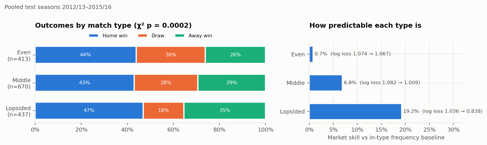

# Predicting Premier League Match Outcomes by Strength Gap

Probabilistic forecasts of English Premier League results (home win / draw / away win) from pre-match data, with an analysis of how predictability changes with the strength gap between the two teams.

*Columbia University · Data Analysis and Machine Learning (DAML) · Group 8*

## Table of Contents

- [Overview](#overview)
- [Results](#results)
- [Repository Structure](#repository-structure)
- [Installation](#installation)
- [Data](#data)
- [Reproducing the Results](#reproducing-the-results)
- [Methodology](#methodology)
- [Documentation](#documentation)
- [Acknowledgments](#acknowledgments)

## Overview

Some football matches are far easier to forecast than others. This project quantifies that effect on 3,040 Premier League matches (2008/09–2015/16) and asks three questions:

1. Can unsupervised learning separate *even*, *middle* and *lopsided* matches, and do these types differ in outcomes and predictability?
2. Within each type, how close do models get to the betting market, and which pre-match features add value?
3. Should models be trained on matches of the same type, on all matches, or on a combination of both?

All features use information available before kick-off. Bookmaker odds serve only as a benchmark and are never used as model inputs. Models are evaluated with a rolling, season-by-season backtest on four held-out seasons (2012/13–2015/16, 1,520 matches).

## Results

**Overall performance** on all 1,520 test matches. Lower log loss is better. *Gap closed* measures how much of the distance from the historical-frequency baseline to the market a method covers.

| Method | Log loss | Gap closed |
|---|---|---|
| Frequency baseline (historical outcome shares) | 1.0735 | 0% |
| Player ratings only (logistic regression) | 1.0041 | 71% |
| XGBoost (best feature set) | 0.9970 | 78% |
| Random forest (best feature set) | 0.9890 | 86% |
| Goal-difference gap only (logistic regression) | 0.9862 | 89% |
| Logistic regression, team performance features | 0.9853 | 90% |
| **Blend of per-type and global logistic regression** | **0.9836** | **92%** |
| Betting market (benchmark) | 0.9754 | 100% |

**By match type** (pooled test seasons):

| Match type | Test matches | Draw rate | Market improvement over frequency baseline | Gap closed by goal-difference model |
|---|---|---|---|---|
| Even | 413 | 30.0% | 0.7% | 66% |
| Middle | 670 | 27.6% | 6.8% | 71% |
| Lopsided | 437 | 17.6% | 19.2% | 99% |

**Main findings**

- **Predictability is driven by the strength gap.** Evenly matched games are close to random even for the market, while lopsided games are largely predictable.
- **A single feature carries most of the signal.** The difference in average goal difference over the last 38 matches, used in a logistic regression, matches or nearly matches every more complex alternative.
- **Results-based strength beats player ratings.** Goal difference contains almost all the information in FIFA ratings, but not the reverse.
- **Model complexity is not the bottleneck.** Tree ensembles clearly improve on a single decision tree but never beat logistic regression; ensembling adds robustness rather than accuracy. The remaining gap to the market is concentrated in middle-type matches, where information such as injuries and team news matters most.

<p align="center">
  <br>
  <em>Outcome shares by match type (left) and how much the market improves on the frequency baseline in each type (right).</em>
</p>

## Repository Structure

```
.
├── README.md
├── requirements.txt
├── run_all.sh               # Runs the full pipeline end to end
├── src/                     # Pipeline code (one module per step)
├── figures/                 # All figures (PNG), regenerated by the pipeline
├── report/
│   ├── report_en.md         # Full report (English)
│   ├── report.md            # Full report (Chinese)
│   ├── key_results.md       # Condensed key results (Chinese)
│   ├── all_results.md       # Every result table, generated automatically
│   └── tables/              # Result tables (CSV)
├── docs/
│   └── technical_notes.md   # Pipeline outputs and data-processing decisions
└── data/processed/          # Intermediate files (created by the pipeline, not tracked)
```

## Installation

Requires Python 3.10 or later (developed with Python 3.12).

```bash
git clone https://github.com/David926926/EPL_forecast.git
cd EPL_forecast
python -m venv .venv
source .venv/bin/activate        # Windows: .venv\Scripts\activate
pip install -r requirements.txt
```

## Data

The raw data is the [European Soccer Database](https://www.kaggle.com/datasets/hugomathien/soccer) on Kaggle (a single SQLite file, about 300 MB). It is not included in this repository because of its size.

1. Download the dataset from Kaggle and unzip it.
2. Place `database.sqlite` in the repository root.

Only the English Premier League matches (league ID 1729) from 2008/09 to 2015/16 are used. The database is read-only; every intermediate file is rebuilt from it.

## Reproducing the Results

Run the full pipeline from the repository root:

```bash
bash run_all.sh
```

This takes about 20 minutes on a laptop and regenerates all intermediate data, figures, result tables and `report/all_results.md`. The steps can also be run individually, in this order:

| Step | Command | Output |
|---|---|---|
| 1. Extract matches | `python -m src.build_matches` | `data/processed/matches.parquet` |
| 2. Build features | `python -m src.features` | `data/processed/features.parquet` |
| 3. Market benchmark | `python -m src.market` | `data/processed/market.parquet`, baseline scores |
| Leakage checks | `python -m src.checks` | Assertion checks (stops on failure) |
| 4. Match types | `python -m src.clustering` | `data/processed/segments.parquet`, `report/tables/cluster_*.csv` |
| 4. Figures | `python -m src.cluster_figures` | `figures/cluster_*.png` |
| 5. Per-type models | `python -m src.per_type_models` | `report/tables/models_*.csv`, `figures/models_*.png` (about 5 min) |
| 6. Training regimes and ensembles | `python -m src.training_regimes` | `report/tables/regimes_*.csv`, `figures/regimes_*.png` (about 6 min) |
| 7. Robustness checks | `python -m src.robustness` | `report/tables/robustness_*.csv`, `figures/robustness_*.png` |
| Result tables | `python -m src.make_output` | `report/all_results.md` |

All random seeds are fixed, so the numbers in the [Results](#results) section should be reproduced exactly.

## Methodology

- **Features**: three nested layers, all computed as home minus away and only from matches played before kick-off:
  1. FIFA ratings of the starting XI by position;
  2. team performance (goal difference and shots on target per match over the last 38 matches, promoted-club flags);
  3. recent form and match context (5-match form, head-to-head record, rest days, season stage, rotation).
- **Match types**: a Gaussian mixture model on three absolute strength-gap variables, with clusters merged into even, middle and lopsided types by a rule fixed in advance.
- **Models**: multinomial logistic regression, CART, random forest, LightGBM, XGBoost and an MLP, tuned on a validation season and refit once before testing.
- **Training regimes**: per-type training, global training, a fixed 50/50 blend of the two, and an equal-weight average of the six models.
- **Evaluation**:
  - metric: multinomial log loss, with Brier score and RPS as checks;
  - validation: a four-fold expanding-window backtest;
  - uncertainty: 95% confidence intervals from a paired bootstrap, cross-checked with a round-level block bootstrap;
  - calibration: reliability curves.

See the [full report](report/report_en.md) for details.

## Documentation

| Document | Contents |
|---|---|
| [`report/report_en.md`](report/report_en.md) | Full report: evaluation method, modeling pipeline, results and interpretation of every figure |
| [`report/report.md`](report/report.md) | Full report in Chinese |
| [`report/key_results.md`](report/key_results.md) | Condensed version with the key figures and numbers (Chinese) |
| [`report/all_results.md`](report/all_results.md) | All result tables, generated by `src/make_output.py` |
| [`docs/technical_notes.md`](docs/technical_notes.md) | Pipeline outputs and data-processing details |

## Acknowledgments

Match data comes from the [European Soccer Database](https://www.kaggle.com/datasets/hugomathien/soccer) by Hugo Mathien on Kaggle; use of the data is subject to the terms stated there.
