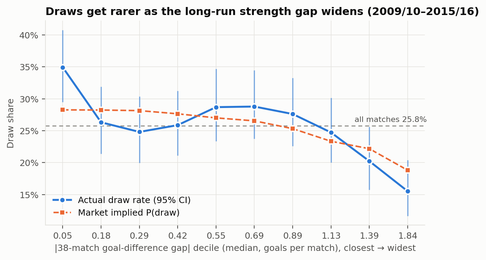
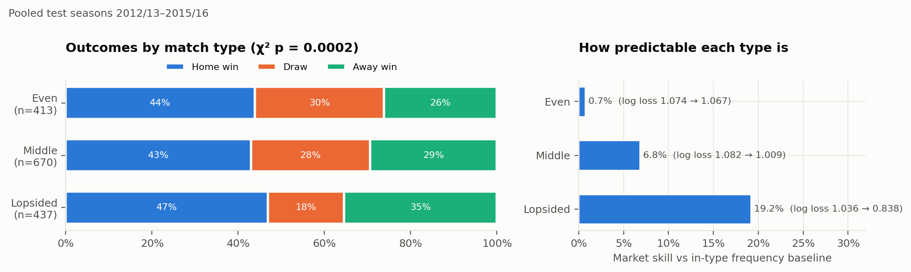
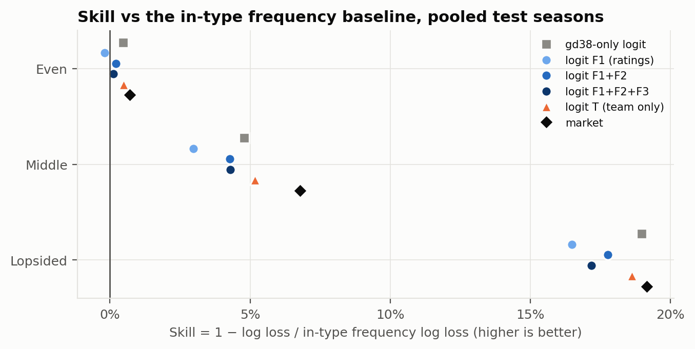
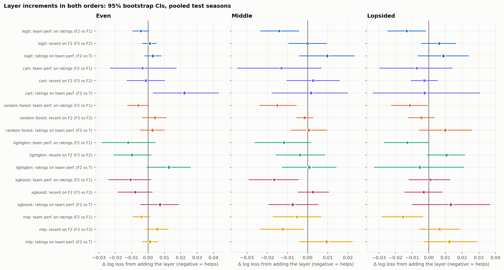
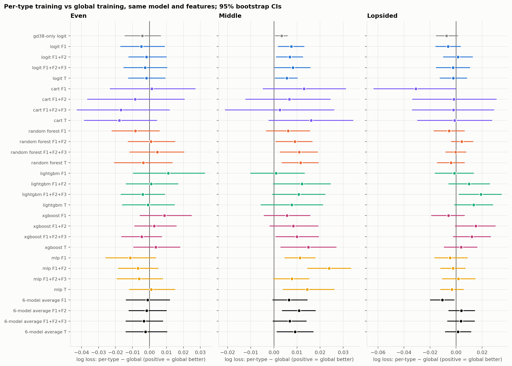
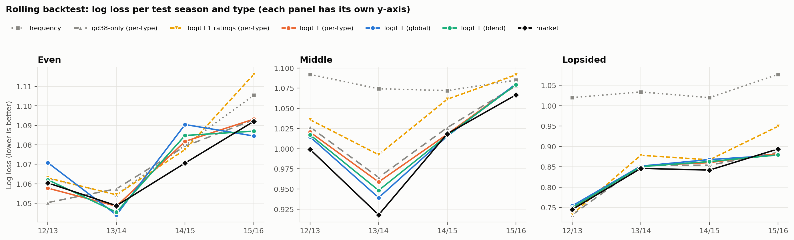
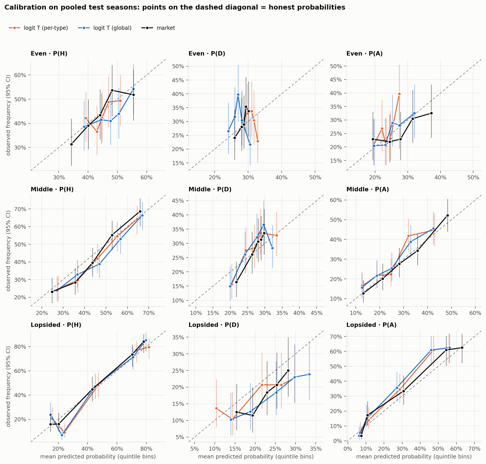

# 关键图表、数据与建模流程

> Group 8 · 2026-11-20 · 英超 2008/09–2015/16（3,040 场）
> 本文只保留关键内容。完整解读见 [report_en.md](report_en.md)，全部数字见 [all_results.md](all_results.md)。

---

## 1. 建模流程

```
database.sqlite（3,040 场英超）
   │
   ├─ Step 1  提取比赛、首发、赔率、事件 XML
   ├─ Step 2  赛前特征（只用开球前信息）：F1 评分 → F2 队伍表现 → F3 近期与情境
   ├─ Step 3  赔率 → 市场概率（只作上限参照，不进入模型）
   ├─ Step 4  无监督：3 个差距特征 → GMM → 势均力敌 / 中间 / 悬殊
   ├─ Step 5  有监督：每种类型内，6 个模型 × 4 组特征 → P(H), P(D), P(A)
   ├─ Step 6  训练方式对比：分类型 / 全局，以及混合集成（两者预测各取一半）、多模型平均
   └─ Step 7  稳健性：分赛季、整块 bootstrap、校准
```

### 1.1 数据切分：滚动回测（4 折，扩展窗口）

| 折 | 训练 | 验证（调参） | 测试 |
|---|---|---|---|
| 1 | 2009/10–2010/11 | 2011/12 | 2012/13 |
| 2 | 2009/10–2011/12 | 2012/13 | 2013/14 |
| 3 | 2009/10–2012/13 | 2013/14 | 2014/15 |
| 4 | 2009/10–2013/14 | 2014/15 | 2015/16 |

- 2008/09 只用来"预热"滚动特征，不参与建模。
- 标准化、聚类、调参都只在该折的训练集和验证集上拟合。
- 结果合并 4 个测试赛季报告，共 1,520 场。

### 1.2 特征（"差"都是主队减客队）

| 层 | 变量 | 个数 |
|---|---|---|
| **F1 球员评分** | 首发门将、后卫、中场、前锋的 FIFA 平均评分差 | 4 |
| **F2 = F1 + 队伍表现** | `gd38_diff`：近 38 场场均净胜球差；`sot38_diff`：近 38 场场均射正差；两个升班马标记 | 8 |
| **F3 = F2 + 近期与情境** | 近 5 场积分、净胜球、射正差；`goal_env`；交锋积分及缺失标记；休息天数差；赛季阶段；首发相比平时的变化 | 17 |
| **T（反向对照）** | 只用 F2 新增的 4 个队伍表现变量 | 4 |

### 1.3 无监督：比赛分类型（Step 4）

1. **输入**：3 个差距特征，都取绝对值：\|gd38_diff\|、\|首发平均评分差\|、\|近 5 场积分差\|。
2. **标准化**：只用训练集计算均值和标准差。
3. **GMM**：在 k = 2…6 和 4 种协方差形状里按 BIC 选，每一折都选了 k = 6。K-means 作为对照。
4. **合并规则**（事先固定）：
   - 差距最小的簇是**势均力敌**；
   - 从差距最大的簇往下累加，直到占训练集至少 25%，这些簇是**悬殊**；
   - 其余是**中间**。
5. **输出**：每场比赛的类型标签。

### 1.4 有监督：预测 H / D / A（Step 5–6）

| 项目 | 设定 |
|---|---|
| 模型 | 多项逻辑回归（L2）、单棵决策树 CART、随机森林（sigmoid 校准）、LightGBM 和 XGBoost（验证集提前停止）、MLP（16 个隐藏单元，5 个种子取平均） |
| 特征组 | F1、F1+F2、F1+F2+F3、T |
| 基线 | ① 频率基线：本类型的历史比例；② 只用 gd38 的逻辑回归；③ 市场 |
| 调参 | 在验证赛季上按 log loss 选超参数 → 用训练加验证集重新拟合 → 测试赛季只预测一次 |
| 训练方式与集成（Step 6） | 分类型：只用本类型的比赛；全局：全部比赛；混合集成：两者的预测各取一半；多模型平均：6 个模型的预测取平均。权重事先固定，都在本类型的测试比赛上评估 |

### 1.5 评估

| 指标 | 定义 |
|---|---|
| **log loss**（主指标） | −mean log p(实际结果)，越低越好。均匀猜 = 1.099 |
| RPS、Brier | 辅助指标，结论一致 |
| 技能分数 | 1 − 模型 log loss ÷ 频率基线 |
| 走完的比例 | (频率基线 − 模型) ÷ (频率基线 − 市场) |
| 显著性 | 配对 bootstrap（按比赛重抽样 2,000 次）；Step 7 另做按轮次整块重抽样 |

---

## 2. 关键结果

### 2.1 实力差距越大，平局越少（Step 2、4）



- 按 `gd38_diff` 五等分，主胜率从 21% 单调升到 74%。
- 按 \|gd38_diff\| 五等分，平局率从 30.7% 降到 17.8%。

### 2.2 三种类型差别很大（Step 4，Q1）



| 类型 | 测试场数 | 主胜 | 平 | 客胜 | 频率基线 | 市场 | 市场的技能分数 |
|---|---|---|---|---|---|---|---|
| 势均力敌 | 413 | 43.8% | **30.0%** | 26.2% | 1.074 | 1.067 | **0.7%** |
| 中间 | 670 | 43.0% | 27.6% | 29.4% | 1.082 | 1.009 | 6.8% |
| 悬殊 | 437 | 46.9% | **17.6%** | 35.5% | 1.036 | 0.838 | **19.2%** |

- 三类的结果分布显著不同（卡方 p = 0.0002）。
- 但轮廓系数只有 0.27–0.29，说明没有天然的分组；按 \|gd38_diff\| 分位数切三段，效果差不多。

### 2.3 一个实力变量就够了（Step 5，Q2）



| 类型 | 频率基线 | 只用 gd38 | 最好的模型 | 市场 | 只用 gd38 走完的比例 | 市场 − 只用 gd38 |
|---|---|---|---|---|---|---|
| 势均力敌 | 1.0743 | 1.0693 | 逻辑回归 T：1.0690 | 1.0668 | 66% | −0.003 [−0.020, +0.016] |
| 中间 | 1.0824 | 1.0306 | 逻辑回归 T：1.0264 | **1.0090** | 71% | **−0.022 [−0.035, −0.008]** |
| 悬殊 | 1.0360 | **0.8395** | MLP T：0.8400 | 0.8376 | **99%** | −0.002 [−0.019, +0.016] |

### 2.4 特征层的增量：信息是单向包含的（Step 5）



逻辑回归，Δ log loss（负数表示更好），粗体表示 95% 区间不包含 0：

| 对比 | 势均力敌 | 中间 | 悬殊 |
|---|---|---|---|
| 只用评分 − 只用 gd38 | +0.007 | **+0.020** | **+0.026** |
| F2 − F1：在评分之上加队伍表现 | −0.004 | **−0.014** | **−0.013** |
| F2 − T：在队伍表现之上加评分 | +0.003 | +0.010 | +0.009 |
| F3 − F2：再加近期与情境 | +0.001 | −0.000 | +0.006 |

- **评分在 gd38 之上没有增量，而 gd38 在评分之上有增量**：评分里的信息几乎都被净胜球包含了。
- **近期与情境（F3）在任何类型里都没有稳定增量**。
- **复杂模型从来没有超过逻辑回归**。集成模型明显好于单棵决策树：全部比赛上，CART 1.0039 → 随机森林 0.9890；XGBoost 0.9970、LightGBM 1.0000，仍不及逻辑回归 0.9853。

### 2.5 训练方式：要看是哪种类型（Step 6，Q3）



逻辑回归 T 的 log loss，差值 = 分类型 − 全局，正数表示全局更好：

| 类型 | 分类型 / 全局 / 混合集成 | 分类型 − 全局（95% 区间） |
|---|---|---|
| 势均力敌 | 1.0690 / 1.0708 / **1.0684** | −0.002 [−0.012, +0.009] |
| 中间 | 1.0264 / **1.0208** / 1.0231 | **+0.006 [+0.001, +0.010]** |
| 悬殊 | 0.8432 / 0.8454 / **0.8429** | −0.002 [−0.013, +0.008] |

- **中间组**：29 个模型 × 特征组合全部是全局更好，其中 15 个显著；和市场的差距缩小到 +0.012，不再显著。
- **势均力敌组**：两种方式没有差别。
- **混合集成**：在每种类型中都接近两者中更好的一个，势均力敌组和悬殊组还略好于两者；6 个模型的平均没有超过逻辑回归。
- **悬殊组**：线性模型分类型略好，树模型全局更好。

### 2.6 稳健性（Step 7）

**全部 1,520 场测试比赛**

| 模型 | log loss | 走完的比例 |
|---|---|---|
| 频率基线（不分类型） | 1.0735 | 0% |
| 频率基线（各类型自己的比例） | 1.0669 | 7% |
| 只用球员评分 F1（分类型） | 1.0041 | 71% |
| 只用 gd38（分类型） | 0.9862 | 89% |
| 逻辑回归 T（分类型） | 0.9853 | 90% |
| 逻辑回归 T（全局） | 0.9840 | 91% |
| **逻辑回归 T（混合集成）** | **0.9836** | **92%** |
| 市场 | 0.9754 | 100% |

**最好的模型和市场的差距**：0.0086。按比赛重抽样的区间是 [+0.0001, +0.0177]，按轮次整块重抽样是 [−0.0001, +0.0171]，属于边缘显著。



- **分赛季**：结论每一季都大致成立。2015/16（莱斯特城赛季）模型和市场几乎打平：1.033 对 1.032。



- **校准**：概率基本"诚实"。ECE：模型 0.02–0.07，市场 0.01–0.04。
- **偏差一：高估主胜**。模型预测 45–47%，实际是 43%，原因是主场优势逐年变弱。
- **偏差二：全局模型把平局率拉向平均**。悬殊组预测 24.2%，实际 17.6%；势均力敌组预测 27.1%，实际 30.0%。

---

## 3. 关键数字一览

| 结论 | 数字 |
|---|---|
| 平局率随实力差距下降 | 30.0% → 27.6% → 17.6% |
| 市场比频率基线好多少 | 势均力敌 0.7%，中间 6.8%，悬殊 19.2% |
| 只用 gd38 走完的比例 | 66% / 71% / 99%；全部比赛 89% |
| 只用评分走完的比例（全部比赛） | 71% |
| 最好的方法走完的比例（全部比赛） | 92%（混合集成 0.9836 对市场 0.9754） |
| 市场显著领先的唯一类型 | 中间组，−0.022 |
| 全局训练显著更好的类型 | 中间组，25 个组合中 13 个显著 |
| 主胜率的变化（主场优势变弱） | 2009/10 的 50.8% → 2015/16 的 41.3% |
