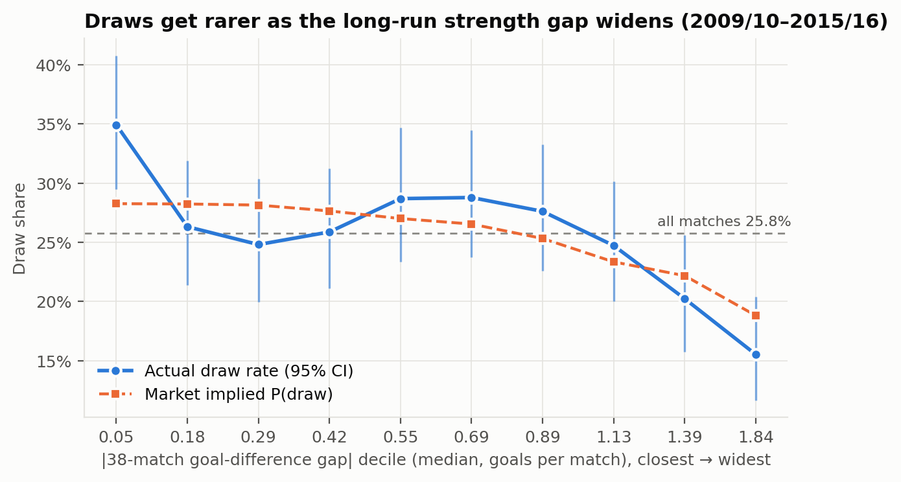
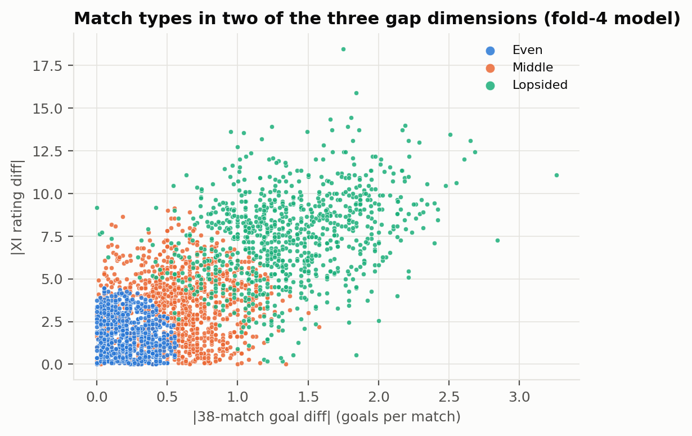
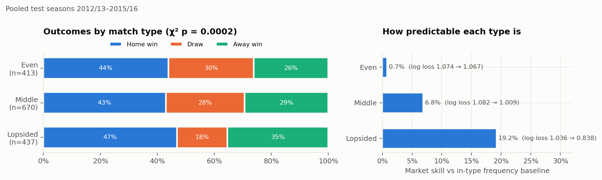
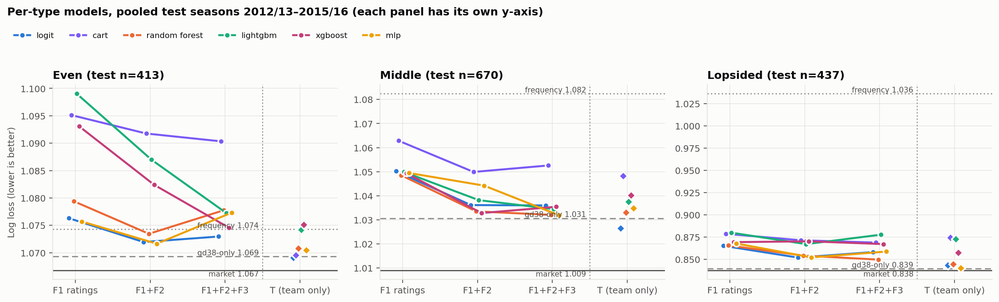
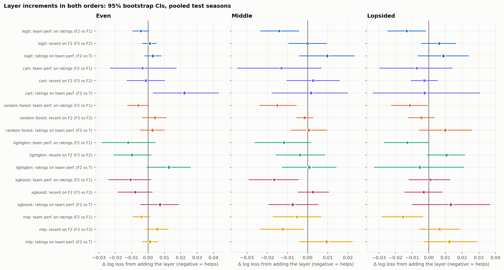
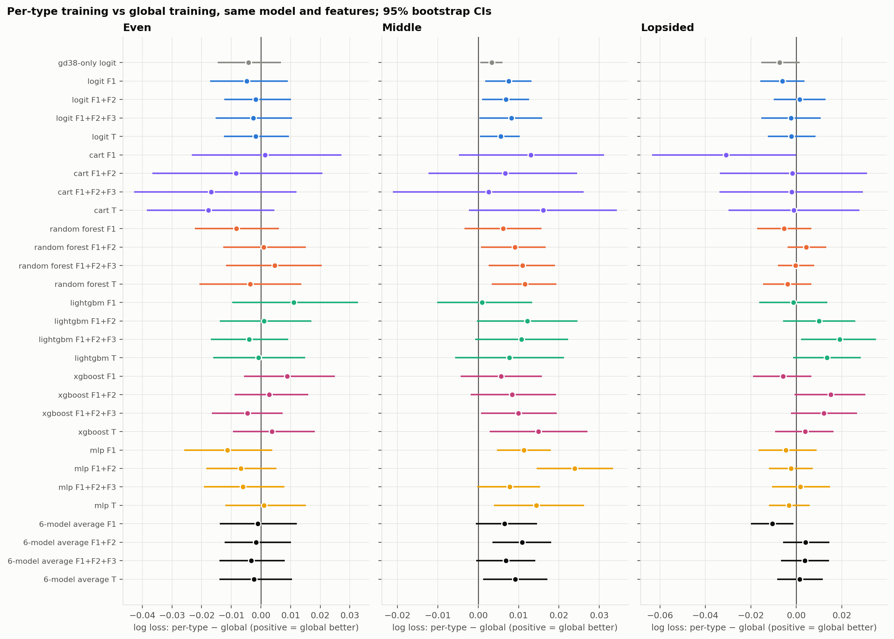
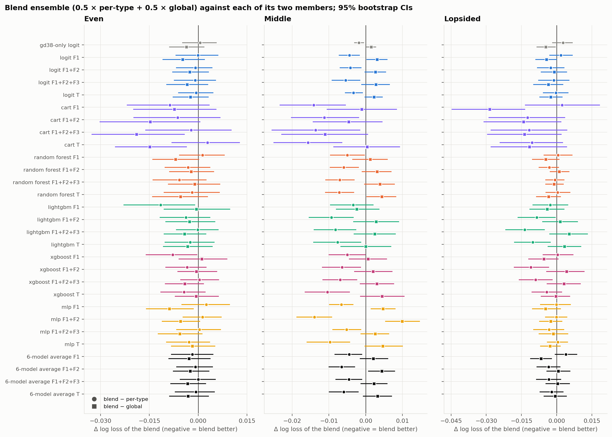
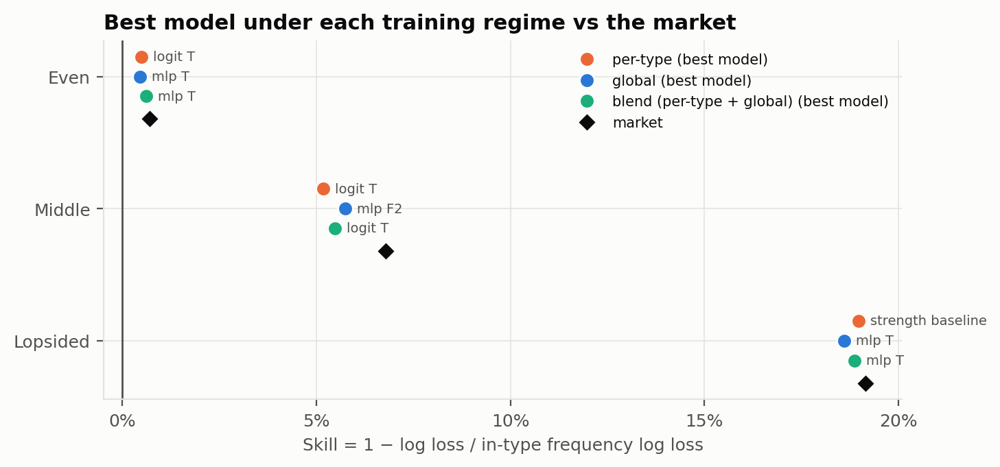
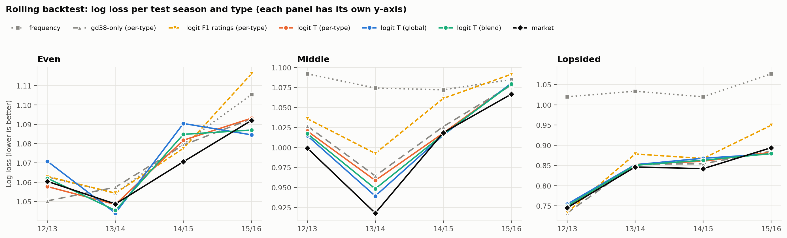
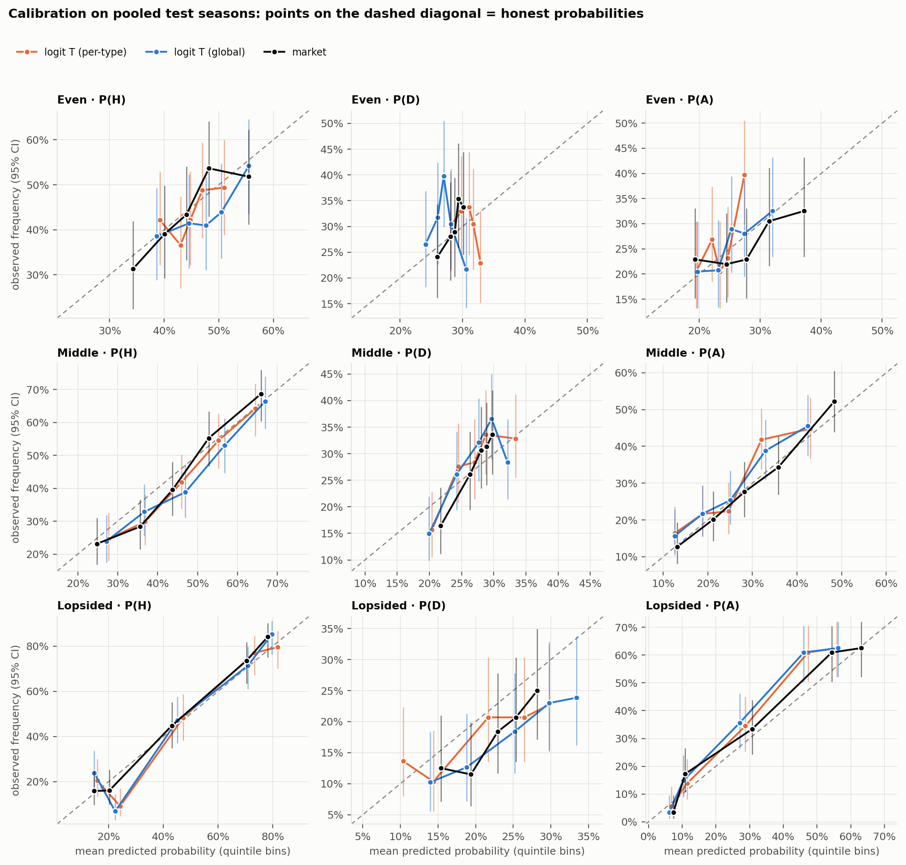

# 按实力差距分类型预测英超比赛结果

> Group 8 · 2026-11-22 · 数据：英超 2008/09–2015/16（3,040 场）
> 全部数字见 [all_results.md](all_results.md)。

---

## 一、研究背景与问题

足球比赛的可预测性因场而异。强弱分明的对阵，结果通常比较确定；实力接近的两队相遇，主胜、平、客胜都有相当的可能。本项目希望定量地刻画这种差异，并检验在不同类型的比赛中，哪些赛前信息真正有助于预测。

**数据**：Kaggle European Soccer Database 中的英超部分，2008/09–2015/16 共 8 个赛季、3,040 场比赛。包括：
- 比分；
- 双方首发名单及位置；
- 球员的 FIFA 评分；
- 比赛事件记录（射门、射正等）；
- 6 家博彩公司的赔率。

**预测任务**：在每场比赛开球前，输出主胜、平、客胜三个概率，下文记作 H、D、A，三者之和为 1。

**研究问题**：
1. 能否按两队实力的接近程度，用无监督学习把比赛分成不同类型？各类型的结果分布和可预测性是否不同？
2. 在每种类型内，模型相对简单基线的提升有多大、离市场还有多远？哪些特征有增量？
3. 训练模型时，应只使用同类型的比赛，还是使用全部比赛？能否通过集成兼顾两者？

下面先说明评估方法，再介绍建模流程，最后依次报告三个问题的结果和稳健性检验。

---

## 二、评估方法

### 评估指标：log loss

模型输出的是三个结果的概率，而比赛结束后只有一个结果发生。因此，评估的核心是：**模型给实际发生的结果分配了多少概率**。分配得越高，预测越好。

log loss 对每场比赛取"实际结果所获概率"的负对数，再对所有比赛求平均：

$$
\text{LogLoss} = -\frac{1}{N}\sum_{i=1}^{N} \ln \hat p_{i,\,y_i}
$$

其中 $y_i$ 是第 $i$ 场比赛的实际结果，$\hat p_{i,\,y_i}$ 是模型给这个结果的概率。log loss 越低越好。

**计算示例**：下面是 2015/16 赛季的 4 场比赛，以及本项目最优模型给出的预测。

| 比赛 | 比分 | 实际结果 | 预测 H / D / A | 实际结果的概率 | 单场损失 |
|---|---|---|---|---|---|
| 阿森纳 vs 曼联 | 3-0 | H | **0.610** / 0.243 / 0.147 | 0.610 | −ln 0.610 = 0.494 |
| 沃特福德 vs 南安普顿 | 0-0 | D | 0.297 / **0.344** / 0.359 | 0.344 | −ln 0.344 = 1.069 |
| 伯恩茅斯 vs 阿斯顿维拉 | 0-1 | A | 0.498 / 0.302 / **0.199** | 0.199 | −ln 0.199 = 1.613 |
| 伯恩茅斯 vs 桑德兰 | 2-0 | H | **0.494** / 0.303 / 0.202 | 0.494 | −ln 0.494 = 0.705 |

这 4 场的 log loss 为 (0.494 + 1.069 + 1.613 + 0.705) / 4 = **0.970**。本报告中的 log loss 都是在测试比赛上按这种方式逐场计算、再取平均得到的。

**这个指标的几个特点**：
- **对数惩罚**：实际结果所获概率越低，损失增长越快。概率为 50% 时损失 0.69，20% 时 1.61，1% 时 4.61。因此，"自信但猜错"会受到很重的惩罚。
- **其余两个概率间接起作用**：三个概率之和为 1，分配给错误结果的概率越多，实际结果所获的概率就越少。
- **它是严格正当的评分规则**：从统计上看，log loss 等于平均每场的负对数似然，也就是多分类的交叉熵。只有当模型报出真实概率时，它的期望值才最小，所以它评估的是概率本身是否准确。
- **它和训练目标一致**：逻辑回归、XGBoost、LightGBM、MLP 在训练时最小化的也是同一个量。
- **一个便于理解的换算**：$e^{-\text{LogLoss}}$ 是模型给实际结果的平均概率（几何平均）。

**参照值**：三个结果各猜 1/3 时，log loss 为 ln 3 ≈ 1.099；完美预测为 0。

**辅助指标**：另外计算了 Brier 分数（概率与 0/1 结果的平方误差）和 RPS（考虑结果顺序，把主胜错猜成平局的惩罚轻于错猜成客胜）。两者的结论与 log loss 一致，正文不再单独报告。

### 基线

为了判断一个 log loss 数值的高低，本项目设置了三个基线。

**频率基线**：不使用任何球队信息，每场比赛都按训练期的历史结果比例来预测。
- 例如预测 2015/16 赛季时，2009/10–2014/15 的主胜、平、客胜比例分别为 46.5%、25.4%、28.1%，于是该赛季每场比赛的预测都是 (0.465, 0.254, 0.281)。
- 分析某一类型的比赛时，只用该类型的历史比例。例如势均力敌组为 (0.449, 0.304, 0.247)，悬殊组为 (0.491, 0.198, 0.311)。
- 频率基线代表"只知道基本规律"（主场有优势、平局约占四分之一）时的水平，是模型应当超过的**下限**。

**单变量实力基线**：只用一个变量的多项逻辑回归。这个变量是两队近 38 场（约一个赛季）场均净胜球之差，记作 `gd38_diff`。它用来检验更多的特征和更复杂的模型是否带来了额外价值。

**市场基线**：由博彩公司的赔率换算得到的概率。
- **换算方法**：赔率取倒数后，三者之和略大于 1，超出的部分是博彩公司的抽水；将三者分别除以它们的和，就得到去除抽水后的概率。例如赔率 2.00 / 3.40 / 4.00，取倒数得到 0.500 / 0.294 / 0.250，和为 1.044，归一化后为 0.479 / 0.282 / 0.239。
- **市场共识**：对 B365、BW、IW、LB、WH、VC 共 6 家公司的概率取平均。
- **作用**：赔率综合了实力、状态、伤病、阵容等几乎所有公开信息，因此作为预测表现的**上限参照**。
- **不作为特征**：赔率只作为基线，不进入任何模型或聚类。如果把赔率作为特征，模型会主要依赖赔率，就无法评估其他赛前数据本身的价值。

### 相对指标

不同类型的比赛本身难度不同，log loss 的绝对值不能直接跨类型比较。为此，本报告使用两个以基线为参照的相对指标。

**走完的比例**：把频率基线到市场基线之间的差距看作一段距离，计算模型覆盖了其中多少。

$$
\text{走完的比例} = \frac{\text{频率基线} - \text{模型}}{\text{频率基线} - \text{市场}}
$$

以中间组为例：频率基线为 1.0824，市场为 1.0090，两者相差 0.0734；单变量实力基线为 1.0306，比频率基线低 0.0518。于是走完的比例 = 0.0518 / 0.0734 ≈ 71%。0% 表示与频率基线持平，100% 表示追平市场。

**技能分数**：模型的 log loss 比本类型的频率基线低了百分之多少。

$$
\text{技能分数} = 1 - \frac{\text{模型}}{\text{频率基线}}
$$

例如悬殊组的频率基线为 1.036，市场为 0.838，市场的技能分数 = 1 − 0.838 / 1.036 ≈ 19%。

### 显著性检验

模型之间的 log loss 差异通常在 0.01 左右，需要判断这样的差异是否超出了抽样误差。本项目使用**配对 bootstrap**：
1. 计算每场比赛上两个模型的损失之差；
2. 对比赛有放回地重抽样 2,000 次，每次计算平均差；
3. 取 2.5% 和 97.5% 分位数，作为 95% 置信区间。

区间不包含 0，即认为差异显著。报告中方括号内的数字都是这样得到的 95% 区间。

---

## 三、建模流程

确定评估方法之后，建模分为以下 7 步：

```
database.sqlite（3,040 场英超）
   │
   ├─ Step 1  提取比赛、首发、赔率、事件记录
   ├─ Step 2  构造赛前特征（只使用开球前可得的信息）
   ├─ Step 3  赔率 → 市场概率（仅作基线）
   ├─ Step 4  无监督学习：按实力接近程度把比赛分成三种类型
   ├─ Step 5  有监督学习：在每种类型内，用不同模型和特征预测 H / D / A
   ├─ Step 6  比较训练方式（同类型 / 全部比赛），并用集成方法把两者结合
   └─ Step 7  稳健性检验
```

### 数据切分：滚动回测

足球数据存在时间上的变化，因此数据严格按时间顺序切分：只用过去的赛季训练，预测之后的赛季。具体采用 4 折扩展窗口的滚动回测：

| 折 | 训练 | 验证（调参） | 测试 |
|---|---|---|---|
| 1 | 2009/10–2010/11 | 2011/12 | 2012/13 |
| 2 | 2009/10–2011/12 | 2012/13 | 2013/14 |
| 3 | 2009/10–2012/13 | 2013/14 | 2014/15 |
| 4 | 2009/10–2013/14 | 2014/15 | 2015/16 |

- **2008/09 不参与建模**：近 38 场等滚动统计需要一个赛季的历史，所以这一季只用于计算特征。
- **拟合范围**：标准化、聚类和调参都只在每一折的训练集和验证集上拟合。
- **结果合并报告**：4 个测试赛季共 1,520 场比赛。
- **为什么用多个测试赛季**：原计划只用 2015/16 作为测试集，但该赛季是莱斯特城夺冠的异常赛季，单一赛季的结果容易受偶然因素影响。

### 特征构造（Step 2）

赛前特征按信息层次分为三层，从球员个人能力，到球队整体表现，再到具体比赛的情境。所有变量都是主队减客队。

| 层 | 变量 | 个数 | 含义 |
|---|---|---|---|
| **F1 球员评分** | 首发门将、后卫、中场、前锋的 FIFA 平均评分差 | 4 | 球员个人能力 |
| **F2 = F1 + 队伍表现** | `gd38_diff`（近 38 场场均净胜球差）、`sot38_diff`（近 38 场场均射正差）、主客队升班马标记 | 8 | 评分之外的团队因素，如战术、教练、默契、阵容深度 |
| **F3 = F2 + 近期与情境** | 近 5 场积分、净胜球、射正差；`goal_env`（两队近期进球与失球之和）；交锋记录及缺失标记；休息天数差；赛季阶段；本场首发与近 10 场首发的评分差 | 17 | 近期状态、轮换和赛程 |

**反向对照 T**：逐层加入特征时，增量的大小取决于加入的顺序，所以另设 T，只包含 F2 新增的 4 个队伍表现变量。这样可以比较两个方向：
- **F2 vs F1**：评分之上加入队伍表现的增量；
- **F2 vs T**：队伍表现之上加入评分的增量。

**防止信息泄露**：
- 所有滚动统计只使用开球前已经结束的比赛；
- 球员评分取比赛日期之前的最近一次；
- 用一套独立实现对 400 场随机比赛重新计算了特征，结果完全一致。

**数据处理**：
- **升班马**：近 38 场中不在英超的场次，用往季升班马的平均水平填补，约每场 −0.5 个净胜球。
- **射正数**：原始事件记录中的射正不含进球，已加回进球数。

### 比赛分类（Step 4，无监督学习）

这一步把比赛按两队实力的接近程度分成三种类型，用于回答第一个问题，同时为后续的分类型建模提供分组。

1. **输入变量**：3 个差距变量，都取绝对值：|近 38 场净胜球差|、|首发平均评分差|、|近 5 场积分差|。取绝对值是因为分类关注的是两队差距的大小，而不是哪一方更强。
2. **标准化**：只用训练集计算均值和标准差。
3. **聚类**：使用高斯混合模型（GMM），在簇数 k = 2…6 和 4 种协方差结构中按 BIC 选择。4 折都选择了 k = 6。K-means 作为对照，它在所有折都选择 k = 2。
4. **合并为三种类型**（规则事先固定）：
   - 差距最小的簇为**势均力敌**；
   - 从差距最大的簇开始累加，直到占训练集至少 25%，这些簇为**悬殊**（实际占比 27–36%）；
   - 其余的簇为**中间**。
5. **输出**：每场比赛的类型标签。

### 分类型建模（Step 5–6，有监督学习）

| 项目 | 设定 |
|---|---|
| 模型 | 6 个：多项逻辑回归（L2 正则化）；单棵决策树 CART（深度 2–6，叶子概率做拉普拉斯平滑，避免出现 0 概率）；随机森林（300 棵树，sigmoid 概率校准）；LightGBM 和 XGBoost（学习率 0.02，在验证集上提前停止）；MLP（16 个隐藏单元，5 个随机种子取平均） |
| 集成学习 | 随机森林（bagging）、LightGBM 和 XGBoost（boosting）都是由多棵决策树组合而成的集成模型。CART 是它们共同的基础学习器，用来衡量集成带来的提升 |
| 特征组 | F1、F1+F2、F1+F2+F3、T |
| 调参与预测 | 在验证赛季上按 log loss 选择超参数；用训练集和验证集重新拟合；对测试赛季只预测一次 |
| Step 5 | 每种类型只用本类型的比赛训练，并与三个基线比较 |
| Step 6 | 同样的模型和特征改用全部比赛训练；再用两种事先固定权重的集成方法组合预测：混合集成把分类型与全局预测各取一半，多模型平均对 6 个模型的预测取平均 |

---

## 四、比赛分类结果（问题 1）

### 实力差距与平局率

分类之前，先看实力差距与比赛结果之间的关系。



**图的含义**：
- **横轴**：把全部比赛按 |近 38 场净胜球差| 从小到大分成 10 组，刻度为每组的中位数。
- **蓝线**：各组实际的平局率，竖线为 95% 区间。
- **橙线**：市场给出的平均平局概率。
- **灰色虚线**：总体平局率 25.8%。

**结论**：
- 差距最小的一组平局率约 35%，差距最大的一组约 15%，整体随差距增大而下降。
- 市场的平局概率也随差距下降，但变化更平缓。在差距最小的一组，市场给出约 28%，低于实际的约 35%。这是"市场可能低估势均力敌比赛平局"的初步迹象，但区间较宽，证据有限。

这一关系说明，按实力差距对比赛分类是有依据的。

### 聚类结果



**图的含义**：第 4 折模型下的分类结果。每个点是一场比赛，横轴是 |近 38 场净胜球差|，纵轴是 |首发评分差|，颜色表示类型。第三个差距变量（近 5 场积分差）未画出。

**结论**：
- 势均力敌组集中在左下角，悬殊组分布在右上方，中间组介于两者之间。
- 三组之间没有明显的间隔，而是连续过渡。轮廓系数只有 0.27–0.29，说明数据中不存在清晰的自然分组。
- 作为对照，直接按 |gd38_diff| 的分位数切成三段，三段的平局率为 30.5% / 28.0% / 17.0%，区分效果与 GMM 相当。
- 分组本身是稳定的：换 10 个随机种子重新拟合，88–99% 的比赛类型保持不变。

### 各类型的结果分布与可预测性



**图的含义**：4 个测试赛季合并的结果。
- **左图**：各类型实际的主胜、平、客胜比例。
- **右图**：市场在各类型中的技能分数，即市场比该类型的频率基线好多少，括号中是两者的 log loss。

| 类型 | 测试场数 | 主胜 | 平 | 客胜 | 频率基线 | 市场 | 市场的技能分数 |
|---|---|---|---|---|---|---|---|
| 势均力敌 | 413 | 43.8% | **30.0%** | 26.2% | 1.074 | 1.067 | **0.7%** |
| 中间 | 670 | 43.0% | 27.6% | 29.4% | 1.082 | 1.009 | 6.8% |
| 悬殊 | 437 | 46.9% | **17.6%** | 35.5% | 1.036 | 0.838 | **19.2%** |

**结论**：
- **结果分布显著不同**：平局率从 30.0% 降到 17.6%，卡方检验 p = 0.0002。
- **可预测性差异更大**：在悬殊组，市场比频率基线好 19.2%；在势均力敌组只好 0.7%。即使是掌握信息最多的市场，也几乎无法预测势均力敌的比赛。

**问题 1 的回答**：按实力接近程度划分的三种类型，在结果分布和可预测性上差异显著；但这种差异是一个连续的梯度，聚类没有发现天然存在的类型，其效果与按净胜球差的分位数切分相当。

---

## 五、分类型建模结果（问题 2）

在得到三种类型之后，下一步是在每种类型内训练模型，比较它们与三个基线的差距。



**图的含义**：
- **三个面板**：分别对应三种类型。各面板的纵轴刻度不同，不能跨面板比较。
- **横轴**：前三个位置是逐层加入的特征组（F1 → F1+F2 → F1+F2+F3），以折线相连；最右侧的菱形是反向对照 T。
- **六种颜色**：六个模型。
- **三条水平线**：点线是频率基线，虚线是单变量实力基线，实线是市场。
- 数值越低越好。

**结论**：
- **悬殊组**：各模型都远低于频率基线，并接近市场。
- **势均力敌组**：所有模型都集中在频率基线附近。
- **中间组**：模型明显优于频率基线，但与市场之间仍有差距。
- **没有模型稳定地低于虚线**：在三种类型中，更多的特征和更复杂的模型，都没有稳定地超过单变量实力基线。

| 类型 | 频率基线 | 单变量实力基线 | 最优模型 | 市场 | 单变量基线走完的比例 | 市场相对单变量基线的优势 |
|---|---|---|---|---|---|---|
| 势均力敌 | 1.0743 | 1.0693 | 1.0690（逻辑回归 T） | 1.0668 | 66% | 0.003 [−0.016, +0.020] |
| 中间 | 1.0824 | 1.0306 | 1.0264（逻辑回归 T） | 1.0090 | 71% | **0.022 [+0.008, +0.035]** |
| 悬殊 | 1.0360 | 0.8395 | 0.8400（MLP T） | 0.8376 | **99%** | 0.002 [−0.016, +0.019] |

**问题 2 的回答**：
- **悬殊组**：只用 `gd38_diff` 一个变量，就覆盖了从频率基线到市场 99% 的距离。这类比赛的结果主要由实力决定，而近一个赛季的净胜球已经能较好地刻画实力。
- **势均力敌组**：频率基线与市场本身只相差 0.0075，各方法之间的差异都在误差范围内。
- **中间组**：这是市场唯一显著领先的类型（0.022，区间不含 0）。实力有差距但不悬殊时，伤病、轮换、战意等信息对结果的影响更大，而这些信息不在本项目的数据中。

### 单棵决策树与集成模型

在 6 个模型中，有 4 个与决策树有关：
- **CART**：单棵决策树。它按特征的取值把比赛逐层切分，每个叶子节点里的结果比例就是预测概率。
- **随机森林**：bagging 方法。对训练数据有放回地抽样，训练 300 棵树，再对它们的预测取平均。
- **LightGBM 和 XGBoost**：boosting 方法。一棵接一棵地训练小树，每棵树修正前面所有树的误差，最后把它们加起来。

这三类模型用的都是树，区别只在于"怎么组合"。所以把它们放在一起比较，就能看出集成本身带来了多少提升。下表是全部 1,520 场测试比赛上的结果，每个模型取 4 组特征中最好的一组（都是 T）。走完的比例以不区分类型的频率基线（1.0735）为起点、市场（0.9754）为终点，具体计算方式见第八节。

| 模型 | 类别 | log loss | 走完的比例 |
|---|---|---|---|
| CART | 单棵树 | 1.0039 | 71% |
| LightGBM | boosting | 1.0000 | 75% |
| XGBoost | boosting | 0.9970 | 78% |
| 随机森林 | bagging | 0.9890 | 86% |
| MLP | 神经网络（5 个种子平均） | 0.9885 | 86% |
| 逻辑回归 | 线性模型 | **0.9853** | **90%** |
| 单变量实力基线（参照） | 线性模型 | 0.9862 | 89% |

**结论**：
- **集成明显优于单棵树**：从 CART 到随机森林，log loss 从 1.0039 降到 0.9890。单棵树的预测随训练数据波动很大，对许多棵树取平均能显著降低这种波动。
- **bagging 优于 boosting**：随机森林好于 XGBoost 和 LightGBM。数据量小、噪声大时，boosting 逐步修正误差的过程更容易拟合到噪声；而 bagging 只做平均，更加稳健。XGBoost 和 LightGBM 的表现接近。
- **调参也反映了数据的特点**：CART 在大多数折和类型中选择了深度 2，也就是只切两层，基本相当于按净胜球差把比赛分成几段。
- **集成模型仍未超过逻辑回归**：即使是最好的集成模型，也略差于逻辑回归和单变量实力基线。在这份数据中，结果与实力差距之间接近单调的平滑关系，线性模型已经能很好地描述，树模型的分段近似反而损失了精度。

---

## 六、特征层分析

第五节表明，最有效的信息是近 38 场的净胜球。这一节进一步分析各层特征的作用，尤其是球员评分与队伍表现之间的关系。



**图的含义**：
- **三个面板**：对应三种类型。
- **每一行**：一个模型的一次比较。圆点为 F2 vs F1（评分之上加入队伍表现），方块为 F3 vs F2（再加入近期与情境），菱形为 F2 vs T（队伍表现之上加入评分）。
- **横轴**：加入特征后 log loss 的变化，横线为 95% 区间。
- **读法**：点位于 0 左侧表示加入后预测更好；横线完全位于 0 左侧表示提升显著。

逻辑回归的结果如下（log loss 的变化，负数表示改善，粗体表示显著）：

| 比较 | 势均力敌 | 中间 | 悬殊 |
|---|---|---|---|
| 只用评分 − 只用 gd38 | +0.007 | **+0.020** | **+0.026** |
| F2 − F1：评分之上加入队伍表现 | −0.004 | **−0.014** | **−0.013** |
| F2 − T：队伍表现之上加入评分 | +0.003 | +0.010 | +0.009 |
| F3 − F2：再加入近期与情境 | +0.001 | −0.000 | +0.006 |

**结论**：
- **只用球员评分的预测力弱于只用净胜球**：在中间组和悬殊组差异显著。在全部测试比赛上，只用评分走完 71% 的距离，只用 `gd38_diff` 走完 89%。
- **评分之上加入队伍表现，提升显著**：逻辑回归和随机森林在中间组、悬殊组均显著，XGBoost 在中间组显著，MLP 在悬殊组显著。
- **队伍表现之上加入评分，没有提升**：6 个模型 × 3 种类型共 18 次比较，没有一次显著改善，点估计多为正值；CART 在势均力敌组甚至显著变差。
- **两个方向合起来，说明信息是单向包含的**：评分中的信息基本已被净胜球包含，而净胜球包含评分所没有的信息。可能的原因是：FIFA 评分更新频率低、粒度较粗，且只反映球员个人能力；近 38 场净胜球直接来自实际比赛结果，综合了教练、战术、默契、阵容深度等因素。
- **近期与情境（F3）没有稳定增量**：18 次比较中只有 1 次显著（MLP，中间组），与随机出现的预期次数相当。
- **复杂模型没有超过逻辑回归**：每种类型只有几百场训练比赛，CART、随机森林、LightGBM、XGBoost、MLP 等灵活模型带来的方差大于它们的收益。

---

## 七、训练方式比较与模型集成（问题 3）

第五、六节的模型都只用本类型的比赛训练，每个模型的训练样本只有 175–740 场。这一节先比较两种训练方式，再用两种简单的集成方法把它们结合起来。**所有方法在评估时都只使用本类型的测试比赛**，调参也都使用本类型的验证比赛。

| 方法 | 做法 |
|---|---|
| **分类型** | 只用本类型的比赛训练（即第五节的模型） |
| **全局** | 用全部比赛训练，训练样本是分类型的 3–4 倍 |
| **混合集成** | 同一模型、同一特征组，把分类型和全局两个版本的预测概率各取一半：$\hat p_{\text{混合}} = 0.5\,\hat p_{\text{分类型}} + 0.5\,\hat p_{\text{全局}}$ |
| **多模型平均** | 对 6 个模型的预测概率取等权平均，在上面三种方式下分别计算 |

两种集成的权重都事先固定，不在测试集上调整，因此不存在挑选结果的问题；它们直接组合已有的预测，不需要重新训练。

### 分类型与全局训练



**图的含义**：
- **每一行**：一个"模型 × 特征组"（最下方 4 行是多模型平均）。模型和特征不变，只改变训练数据。
- **点**：分类型训练的 log loss 减去全局训练的 log loss。
- **读法**：点位于 0 右侧表示全局训练更好；横线（95% 区间）完全位于右侧表示显著。

**结论**：
- **中间组**：29 个组合全部位于 0 右侧，其中 15 个显著。全局训练明显更好。
- **势均力敌组**：大多跨过 0，没有差别。
- **悬殊组**：线性模型略偏左（分类型略好，不显著），boosting 模型偏右（全局更好）。显著的只有 3 项：LightGBM 在 F1+F2+F3 上全局更好；CART 和模型平均在只用评分时分类型更好。

**原因分析**：训练方式的效果取决于两方面因素。
1. **全局训练的样本更多，覆盖的实力差距范围更完整**，因此能更准确地估计实力差距与结果之间的关系。
2. **分类型训练能直接学到本类型的基础结果比例**，例如势均力敌组约 30% 的平局率、悬殊组约 18% 的平局率。全局模型只能通过实力变量间接推断这些比例，在两端的类型中容易出现偏差。

三种类型的结果与这两方面因素一致：
- **中间组**：组内实力差距范围较窄，分类型训练难以估计差距与结果的关系；而其平局率接近总体平均，全局训练没有劣势。因此全局训练更好。
- **悬殊组**：组内差距范围本身较宽，平局率远离总体平均，因此分类型训练略好。
- **势均力敌组**：两方面因素都较弱，两种方式没有差别。

### 混合集成：结合分类型与全局预测

既然两种训练方式各有所长，而且哪一种更好取决于比赛类型，混合集成就不在两者之间二选一，而是把它们的预测各取一半。

**为什么可能比两者都好**：
- **两个模型在不同的比赛上犯错**：有的比赛分类型更准，有的比赛全局更准，平均后彼此的失误被部分抵消。
- **数学上有保证**：由于对数函数是凹函数，先平均概率再取 −ln，不会大于先取 −ln 再平均。因此混合集成的 log loss 一定不高于两个成员 log loss 的平均值；当两者"错的地方不同"时，还可能低于其中更好的那个。



**图的含义**：
- **每一行**：一个"模型 × 特征组"。
- **圆点**：混合集成减去分类型版本；**方块**：混合集成减去全局版本；横线为 95% 区间。
- **读法**：点位于 0 左侧，表示混合集成比该成员更好。

**结论**（每种类型 29 个组合）：
- **势均力敌组**：混合集成有 28 个组合好于全局（3 个显著），21 个好于分类型（2 个显著）。
- **悬殊组**：混合集成各有 21 个组合好于全局和分类型（分别有 3 个和 5 个显著）。
- **中间组**：混合集成全部 29 个组合都好于分类型（28 个显著），但有 25 个略差于全局（6 个显著），落在两者之间、更接近全局。
- **总体**：混合集成在任何类型中都没有显著差于分类型；只有在中间组，它略逊于全局训练。

逻辑回归 T 的具体数字（log loss）：

| 类型 | 分类型 | 全局 | **混合集成** | 混合集成 − 分类型 | 混合集成 − 全局 |
|---|---|---|---|---|---|
| 势均力敌 | 1.0690 | 1.0708 | **1.0684** | −0.001 [−0.006, +0.005] | −0.002 [−0.008, +0.003] |
| 中间 | 1.0264 | **1.0208** | 1.0231 | **−0.003 [−0.006, −0.001]** | +0.002 [−0.000, +0.005] |
| 悬殊 | 0.8432 | 0.8454 | **0.8429** | −0.000 [−0.006, +0.005] | −0.003 [−0.007, +0.003] |

混合集成的价值主要在于**稳健**：不需要事先知道每种类型该用哪种训练方式，在每种类型中它都接近两者中更好的那个，在势均力敌组和悬殊组甚至略好于两者。它在准确率上的提升很小，都在误差范围之内。

### 多模型平均

在 3 种训练方式 × 4 组特征 × 3 种类型共 36 次比较中，6 个模型的平均与逻辑回归相比，**没有一次显著更好**，其中 20 次点估计更差。原因是成员质量不一：CART 和 boosting 模型本身明显弱于逻辑回归，等权平均会把整体拉低。集成只有在成员都比较准确、且误差各不相同时才有帮助。

### 各方法的最佳水平与市场



**图的含义**：
- **纵轴**：三种类型。
- **横轴**：技能分数，即比本类型频率基线好了百分之多少。0% 表示与频率基线持平，越往右越好。这里用技能分数而不是 log loss，是因为三种类型的难度不同，log loss 不能直接比较。
- **每行有 4 个标记**：
  - 三个彩色圆点：分别是分类型、全局、混合集成三种方式下 log loss 最低的模型，标签标明了模型和特征组。"logit T" 指只用队伍表现的逻辑回归，"strength baseline" 指单变量实力基线。
  - 黑色菱形：市场。
- **读法**：圆点与菱形之间的水平距离，就是该方式下的最佳模型与市场的差距。

| 类型 | 分类型最优 | 全局最优 | 混合集成最优 | 市场 | 解读 |
|---|---|---|---|---|---|
| 势均力敌 | 0.5% | 0.5% | **0.6%** | 0.7% | 所有标记都在 0 附近，市场本身也只比频率基线好 0.7% |
| 中间 | 5.2% | **5.7%** | 5.5% | 6.8% | 全局训练最接近市场，混合集成次之，但都与市场相差 1 个百分点以上 |
| 悬殊 | **19.0%** | 18.6% | 18.9% | 19.2% | 所有标记都接近市场，单变量实力基线已经足够 |

需要注意，图中的"最优模型"是在测试结果上挑选出来的，因此这张图偏乐观，仅用于直观展示差距的大小。正式的比较以前两张图的配对检验为准。

**中间组与市场的差距**（逻辑回归 T）：
- 分类型：+0.017 [+0.003, +0.031]，显著；
- 全局：+0.012 [−0.002, +0.025]，不显著；
- 混合集成：+0.014 [+0.001, +0.027]，刚好显著。

**问题 3 的回答**：不存在对所有类型都最优的训练方式。中间组宜使用全部比赛训练；悬殊组只用本类型的比赛即可；势均力敌组没有差别。如果希望使用统一的方法，**把两种预测各取一半的混合集成是一个稳健的选择**：它在每种类型中都接近两者中更好的一个，全部测试比赛上的 log loss 也是所有方法中最低的（见第八节）。对多个模型取平均则没有帮助。

---

## 八、稳健性检验（Step 7）

最后，从整体表现、分赛季结果和概率校准三个方面检验以上结论是否稳健。这一步不重新训练模型，只使用 Step 5–6 已保存的预测。

### 全部测试比赛的表现

将三种类型的预测合并，得到全部 1,520 场测试比赛的结果。这里的走完的比例，以不区分类型的频率基线为起点。

| 模型 | log loss | 走完的比例 |
|---|---|---|
| 频率基线（不区分类型） | 1.0735 | 0% |
| 频率基线（各类型分别统计） | 1.0669 | 7% |
| 只用球员评分（分类型） | 1.0041 | 71% |
| 单变量实力基线（分类型） | 0.9862 | 89% |
| 逻辑回归 T（分类型） | 0.9853 | 90% |
| 逻辑回归 T（全局） | 0.9840 | 91% |
| **逻辑回归 T（混合集成）** | **0.9836** | **92%** |
| 市场 | 0.9754 | 100% |

**结论**：
- **类型本身带有信息**：只要知道比赛所属的类型，并按该类型的历史比例预测，就能覆盖 7% 的距离。
- **最优方法覆盖了 92% 的距离**：混合集成的 log loss 为 0.9836，平均给实际结果 37.4% 的概率，市场为 37.7%。它比全局逻辑回归略好 0.0004 [−0.0026, +0.0019]，差异不显著。
- **与市场仍有微小但显著的差距**：混合集成与市场相差 0.0082 [+0.0001, +0.0164]；全局逻辑回归与市场相差 0.0086 [+0.0002, +0.0171]。两者都刚好显著，差距主要来自中间组。
- **按轮次整块重抽样的结论基本不变**：同一轮的比赛可能受共同因素影响，因此另做了按轮次整块重抽样（把同一赛季、同一轮次的比赛作为一个整体抽取）。两种方法的区间宽度之比为 0.83–1.11。只有"全局逻辑回归 vs 市场"一项变为刚好不显著（[−0.0000, +0.0169]），其余显著性结论都不变。

### 分赛季结果



**图的含义**：各测试赛季中关键模型的 log loss，各面板的纵轴刻度不同。
- 灰色点线：频率基线；
- 灰色虚线：单变量实力基线；
- 黄色：只用评分；
- 橙色、蓝色、青色：分类型、全局训练和混合集成的逻辑回归 T；
- 黑色：市场。

**结论**：
- **悬殊组**：每个赛季，模型都远优于频率基线，并接近市场。2015/16 赛季，模型略优于市场（0.879 vs 0.894）。
- **中间组**：4 个赛季中有 3 个赛季市场最优。
- **势均力敌组**：各方法的排序在不同赛季之间变化，说明差异主要是噪声。
- **只用评分的模型在 2015/16 明显变差**：该赛季莱斯特城以中等的阵容评分夺冠，只依赖评分的模型受影响最大。
- **2015/16 单独看**：全局逻辑回归 T 与市场基本持平，1.033 vs 1.032。

### 概率校准

除了 log loss，还需要检验模型给出的概率是否与实际频率一致。例如，在模型预测平局概率约为 30% 的比赛中，实际平局的比例也应当接近 30%。



**图的含义**：
- **布局**：3 × 3 个子图，行是三种类型，列是主胜、平、客胜三个概率。
- **分组**：把预测概率按大小分成 5 组，横轴是每组的平均预测概率，纵轴是该组的实际发生频率，竖线是 95% 区间。
- **读法**：对角虚线表示完全校准。点位于对角线下方，说明模型高估了该结果；位于上方，说明低估了。

**结论**：
- **整体校准良好**：大部分点都在对角线附近，中间组和悬殊组尤其明显。期望校准误差（ECE）方面，模型为 0.02–0.07，市场为 0.01–0.04，市场仍然校准得最好。
- **势均力敌组的平局子图不作解读**：模型在该组给出的平局概率几乎是常数（24–33%），分组后没有足够的变化。
- **偏差一：高估主胜**。在势均力敌组和中间组，模型平均预测主胜 45–47%，实际为 43%。原因是主场优势逐年减弱，主胜率从 2009/10 的 50.8% 降至 2015/16 的 41.3%，而模型用较早的赛季训练，学到的主场优势偏高。
- **偏差二：全局模型的平局概率偏向总体平均**。悬殊组预测 24.2%，实际 17.6%；势均力敌组预测 27.1%，实际 30.0%。这与第七节的原因分析一致。

---

## 九、结论与局限

**主要结论**：
1. **比赛的可预测性主要取决于两队的实力差距。**势均力敌的比赛对包括市场在内的所有方法都接近随机，悬殊的比赛则大部分可以预测。
2. **简单模型已接近最优。**近 38 场净胜球差加上逻辑回归，在三种类型中都达到或接近最佳表现。集成学习能显著弥补单棵决策树的不足（bagging 的效果好于 boosting），但包括随机森林、XGBoost、LightGBM 在内的集成模型都没有超过逻辑回归。
3. **基于比赛结果的实力度量优于基于球员评分的度量。**评分中的信息基本被净胜球包含，反之则不成立。
4. **市场的信息优势集中在中间组。**后续如果补充特征，应针对这一组，例如伤病、赛程密度和比赛动机。
5. **按类型分析的主要价值在于诊断。**按类型切分训练数据并不能普遍提升预测，但按类型评估揭示了可预测性的梯度，也定位了市场优势所在的位置。
6. **集成带来的是稳健性，而不是准确率。**把分类型与全局预测各取一半（混合集成），在每种类型中都接近两者中更好的一个，是统一使用时的稳健选择；对 6 个模型取平均则因为成员质量不一而没有帮助。准确率的上限由信息决定，而不是由模型的组合方式决定。
7. **只用公开的赛前数据，最优方法覆盖了从频率基线到市场 92% 的距离。**

**局限**：
- **样本量有限**：每种类型每折只有 175–740 场训练比赛，置信区间较宽。
- **组内范围受限**：类型按实力差距划分，组内的实力变化被压缩，组内模型接近基线部分是由设计决定的。
- **数据缺口**：休息天数未计入欧战和杯赛；FIFA 评分更新慢且不反映伤病；缺少替补信息。
- **时间漂移**：主场优势逐年减弱，用早期赛季训练的模型会系统性地高估主胜。

**后续工作**：
- **全局模型加入类型变量**：为全局模型加入类型指示变量，兼顾样本量和各类型的基础比例。
- **时间衰减加权**：采用时间衰减加权，修正主场优势的漂移。
- **Step 8**：撰写最终报告并准备展示。

---

## 附录 A：图索引

| 图 | 内容 | 正文位置 |
|---|---|---|
| `cluster_draw_vs_strength_gap` | 平局率和市场平局概率随净胜球差十分位的变化 | 第四节 |
| `cluster_gap_features` | 3 个差距变量的分布和相关性 | — |
| `cluster_model_selection` | 不同 k 和协方差结构下的 BIC 与轮廓系数 | — |
| `cluster_outcomes` | 第 4 折 6 个簇的结果分布及其所属类型 | — |
| `cluster_segment_overview` | 各类型的结果分布和市场技能分数 | 第四节 |
| `cluster_definition_comparison` | GMM、分位数规则、市场最接近 20% 三种定义下的平局率 | — |
| `cluster_test_seasons` | 各测试赛季、各类型的平局率与主胜率 | — |
| `cluster_segment_scatter` | 三种类型在差距空间中的分布 | 第四节 |
| `models_logloss_by_layer` | 各类型、各模型、各特征组的 log loss 及三个基线 | 第五节 |
| `models_skill_by_type` | 各类型的技能分数 | — |
| `models_layer_increments` | 两个方向的层间增量及 95% 区间 | 第六节 |
| `models_coefficients` | 第 4 折逻辑回归系数（按层顺序残差化） | — |
| `regimes_logit_by_regime` | 逻辑回归在分类型、全局、混合集成三种方式下，各特征组的 log loss | — |
| `regimes_pertype_vs_global` | 各"模型 × 特征组"的分类型 − 全局差值 | 第七节 |
| `regimes_blend_vs_members` | 混合集成与其两个成员（分类型、全局）的差值 | 第七节 |
| `regimes_best_by_regime` | 分类型、全局、混合集成三种方式下的最优模型与市场（技能分数） | 第七节 |
| `robustness_season_logloss` | 关键模型在各测试赛季的 log loss | 第八节 |
| `robustness_calibration` | 校准曲线 | 第八节 |
| `robustness_bootstrap_ci` | 按比赛重抽样与按轮次整块重抽样的区间对比 | — |

## 附录 B：复现

```bash
bash run_all.sh    # 从 database.sqlite 重新生成全部结果，约 20 分钟
```

代码位于 `src/`，图位于 `figures/`，结果表位于 `report/tables/`，中间数据位于 `data/processed/`。
