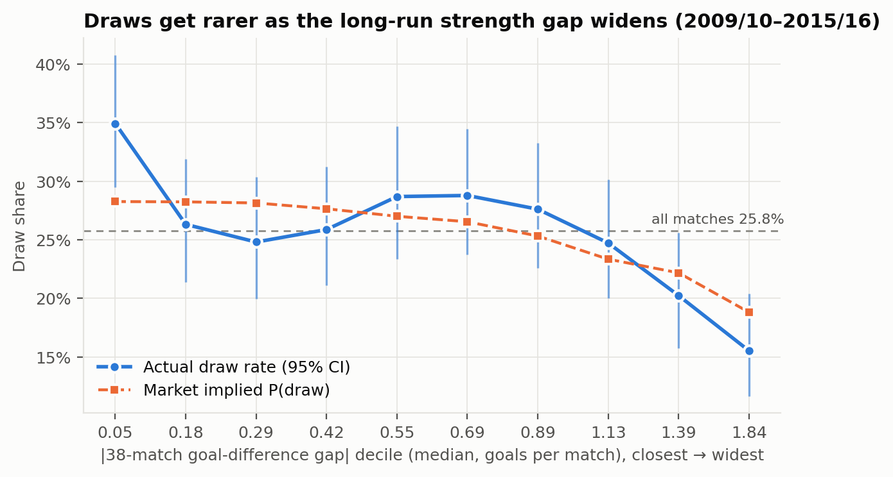
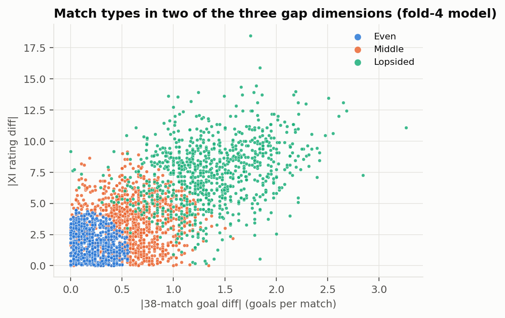
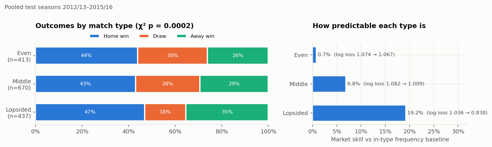
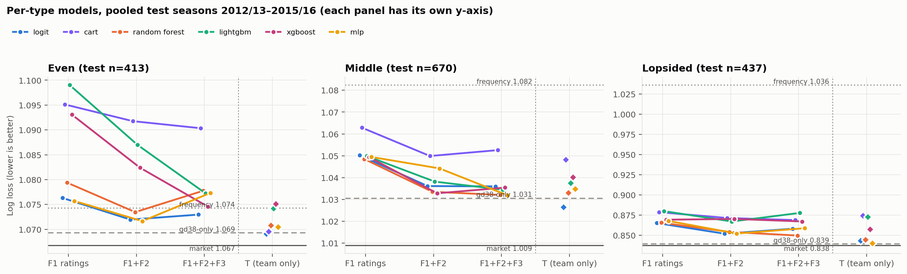
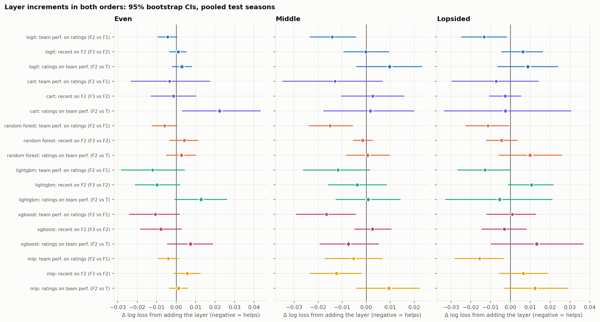
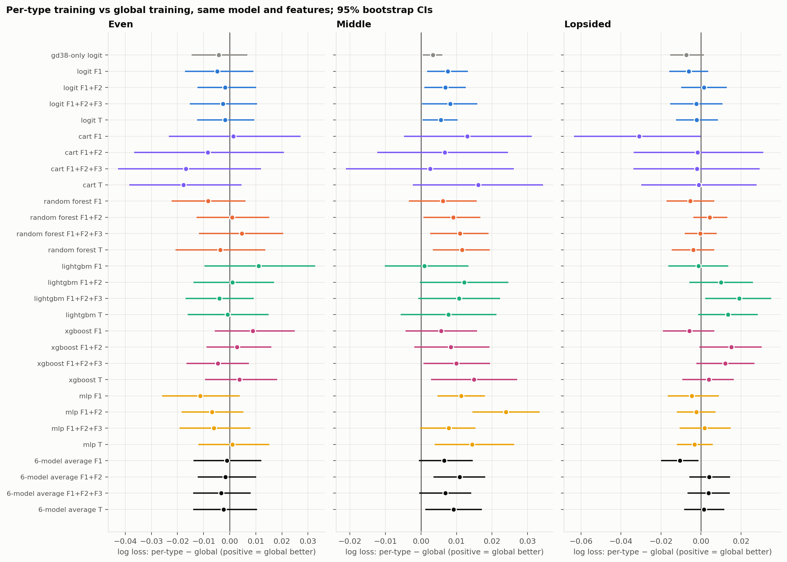
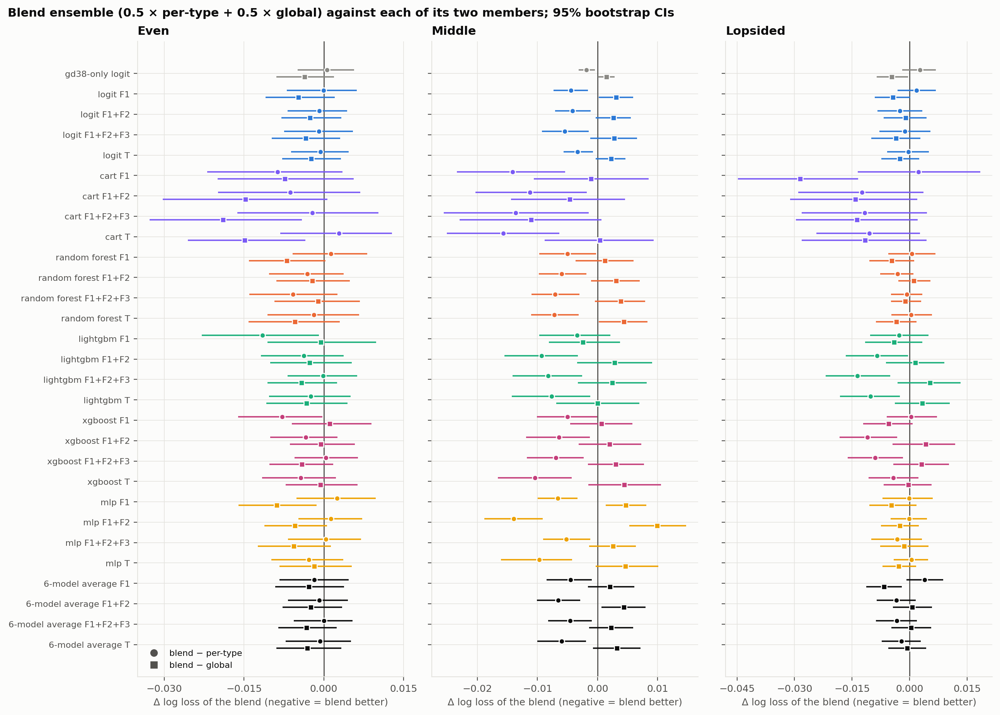
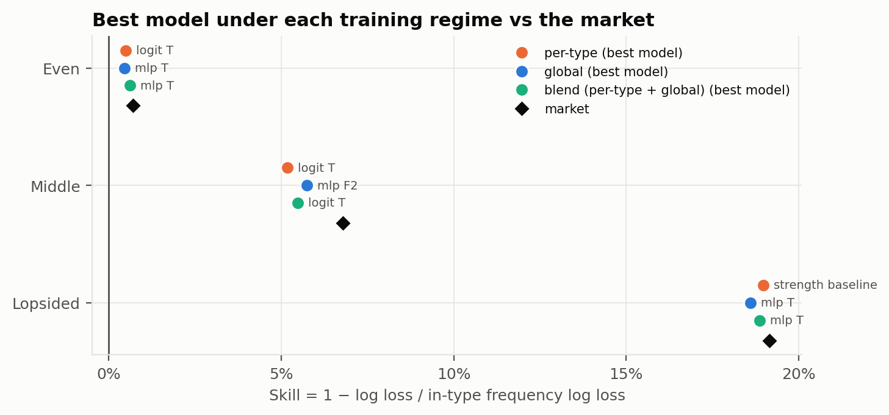
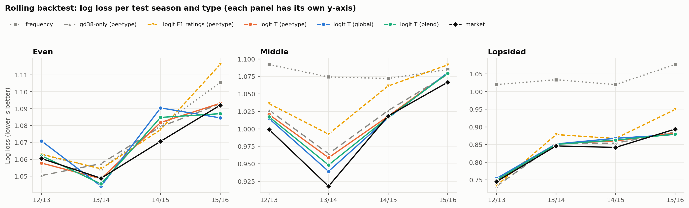
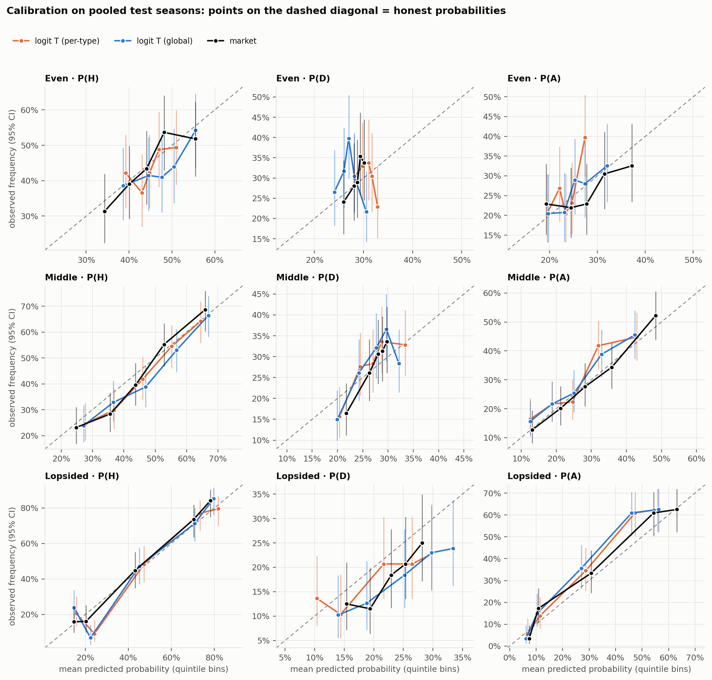

# Predicting EPL Match Outcomes by Strength Gap

> Group 8 · 2026-11-22 · Data: English Premier League 2008/09–2015/16 (3,040 matches)
> All result tables are in [all_results.md](all_results.md).

---

## 1. Background and Research Questions

Football matches differ in how predictable they are. When a strong team meets a weak one, the outcome is usually fairly certain; when two closely matched teams meet, a home win, a draw and an away win are all plausible. This project quantifies that difference and tests which pre-match information actually helps prediction in each kind of match.

**Data**: the English Premier League subset of the Kaggle European Soccer Database, eight seasons from 2008/09 to 2015/16 (3,040 matches). It contains:
- final scores;
- starting line-ups and player positions;
- FIFA player ratings;
- match event records (shots, shots on target, etc.);
- odds from six bookmakers.

**Prediction task**: before each match kicks off, output the probabilities of a home win, a draw and an away win (denoted H, D and A below), which sum to one.

**Research questions**:
1. Can unsupervised learning group matches by how closely matched the two teams are? Do the resulting types differ in outcomes and predictability?
2. Within each type, how much do models improve on simple baselines, and how far do they remain from the betting market? Which features add value?
3. Should a model be trained only on matches of its own type or on all matches? Can an ensemble combine the strengths of both?

The report first describes the evaluation methodology and the modeling pipeline, then presents the results for the three questions and the robustness checks.

---

## 2. Evaluation Methodology

### Evaluation metric: log loss

A model outputs probabilities for three outcomes, but only one outcome occurs. Evaluation therefore centers on **how much probability the model assigned to the outcome that actually happened**. The more probability it assigned, the better the forecast.

Log loss takes the negative logarithm of the probability assigned to the actual outcome in each match and averages over all matches:

$$
\text{LogLoss} = -\frac{1}{N}\sum_{i=1}^{N} \ln \hat p_{i,\,y_i}
$$

where $y_i$ is the actual outcome of match $i$ and $\hat p_{i,\,y_i}$ is the probability the model assigned to it. Lower is better.

**Worked example**: four 2015/16 matches and the forecasts of our best model.

| Match | Score | Actual | Forecast H / D / A | Prob. of actual outcome | Loss for this match |
|---|---|---|---|---|---|
| Arsenal vs Manchester United | 3-0 | H | **0.610** / 0.243 / 0.147 | 0.610 | −ln 0.610 = 0.494 |
| Watford vs Southampton | 0-0 | D | 0.297 / **0.344** / 0.359 | 0.344 | −ln 0.344 = 1.069 |
| Bournemouth vs Aston Villa | 0-1 | A | 0.498 / 0.302 / **0.199** | 0.199 | −ln 0.199 = 1.613 |
| Bournemouth vs Sunderland | 2-0 | H | **0.494** / 0.303 / 0.202 | 0.494 | −ln 0.494 = 0.705 |

The log loss over these four matches is (0.494 + 1.069 + 1.613 + 0.705) / 4 = **0.970**. Every log loss in this report is computed in the same way, match by match over the test matches, and then averaged.

**Properties of the metric**:
- **Logarithmic penalty**: the loss grows quickly as the probability of the actual outcome falls. A probability of 50% costs 0.69, 20% costs 1.61 and 1% costs 4.61, so confident mistakes are punished heavily.
- **The other two probabilities matter indirectly**: because the three probabilities sum to one, any probability placed on wrong outcomes is taken away from the actual one.
- **It is a strictly proper scoring rule**: log loss equals the average negative log-likelihood per match (the multiclass cross-entropy). Its expected value is minimized only when the model reports the true probabilities, so it measures the accuracy of the probabilities themselves.
- **It matches the training objective**: logistic regression, XGBoost, LightGBM and the MLP all minimize this same quantity during training.
- **An intuitive conversion**: $e^{-\text{LogLoss}}$ is the geometric-mean probability the model assigns to the actual outcome.

**Reference values**: guessing 1/3 for every outcome gives ln 3 ≈ 1.099; a perfect forecast gives 0.

**Secondary metrics**: we also computed the Brier score (squared error between the probabilities and the 0/1 outcome) and the ranked probability score, RPS. RPS respects the ordering of outcomes, so mistaking a home win for a draw costs less than mistaking it for an away win. Both lead to the same conclusions as log loss and are not reported separately.

### Baselines

Three baselines put each log loss in context.

**Frequency baseline**: ignore all team information and forecast every match with the historical outcome shares from the training period.
- For example, to forecast 2015/16, the home-win, draw and away-win shares over 2009/10–2014/15 were 46.5%, 25.4% and 28.1%, so every 2015/16 match receives the forecast (0.465, 0.254, 0.281).
- When analyzing one match type, only that type's historical shares are used, e.g. (0.449, 0.304, 0.247) for even matches and (0.491, 0.198, 0.311) for lopsided ones.
- The frequency baseline represents knowing only the basic regularities (home advantage, roughly a quarter of matches drawn). It is the **floor** that a model should beat.

**Single-variable strength baseline**: a multinomial logistic regression on one variable, the difference between the two teams' average goal difference per match over their last 38 matches (about one season), denoted `gd38_diff`. It tests whether additional features and more complex models add any value.

**Market baseline**: probabilities derived from bookmaker odds.
- **Conversion**: the reciprocals of the odds sum to slightly more than one; the excess is the bookmaker's margin. Dividing each reciprocal by their sum removes the margin. For example, odds of 2.00 / 3.40 / 4.00 give reciprocals of 0.500 / 0.294 / 0.250, which sum to 1.044; after normalization the probabilities are 0.479 / 0.282 / 0.239.
- **Market consensus**: the average of the normalized probabilities from six bookmakers (B365, BW, IW, LB, WH, VC).
- **Role**: odds incorporate almost all public information (strength, form, injuries, line-ups), so the market serves as the **upper reference** for forecasting performance.
- **Not a feature**: odds are used only as a baseline and never enter any model or the clustering. If odds were used as features, the models would mostly rely on them, and the value of the other pre-match data could not be assessed.

### Relative metrics

Match types differ in intrinsic difficulty, so absolute log loss values cannot be compared across types. We therefore use two metrics defined relative to the baselines.

**Share of the gap closed**: treat the difference between the frequency baseline and the market as a distance, and measure how much of it a model covers.

$$
\text{Share of gap closed} = \frac{\text{frequency baseline} - \text{model}}{\text{frequency baseline} - \text{market}}
$$

For the middle type, the frequency baseline is 1.0824 and the market 1.0090, a gap of 0.0734. The single-variable strength baseline scores 1.0306, which is 0.0518 below the frequency baseline, so it closes 0.0518 / 0.0734 ≈ 71% of the gap. 0% means no better than the frequency baseline; 100% means matching the market.

**Skill score**: the percentage by which a model's log loss is lower than the frequency baseline of its type.

$$
\text{Skill} = 1 - \frac{\text{model}}{\text{frequency baseline}}
$$

For the lopsided type, the frequency baseline is 1.036 and the market 0.838, so the market's skill is 1 − 0.838 / 1.036 ≈ 19%.

### Significance testing

Differences in log loss between models are typically around 0.01, so we need to know whether they exceed sampling noise. We use a **paired bootstrap**:
1. compute the per-match difference in loss between the two models;
2. resample the matches with replacement 2,000 times and compute the mean difference each time;
3. take the 2.5% and 97.5% quantiles as the 95% confidence interval.

A difference is called significant if the interval excludes zero. All bracketed numbers in this report are 95% intervals obtained this way.

---

## 3. Modeling Pipeline

With the evaluation methodology in place, the modeling proceeds in seven steps:

```
database.sqlite (3,040 EPL matches)
   │
   ├─ Step 1  Extract matches, line-ups, odds and event records
   ├─ Step 2  Build pre-match features (information available before kick-off only)
   ├─ Step 3  Odds → market probabilities (baseline only)
   ├─ Step 4  Unsupervised: group matches into three types by how closely matched the teams are
   ├─ Step 5  Supervised: within each type, forecast H / D / A with several models and feature sets
   ├─ Step 6  Compare training regimes (own type / all matches) and combine them with ensembles
   └─ Step 7  Robustness checks
```

### Data split: rolling backtest

Football data change over time, so the split is strictly chronological: models are trained on past seasons and evaluated on later ones. We use a four-fold expanding-window backtest:

| Fold | Train | Validation (tuning) | Test |
|---|---|---|---|
| 1 | 2009/10–2010/11 | 2011/12 | 2012/13 |
| 2 | 2009/10–2011/12 | 2012/13 | 2013/14 |
| 3 | 2009/10–2012/13 | 2013/14 | 2014/15 |
| 4 | 2009/10–2013/14 | 2014/15 | 2015/16 |

- **2008/09 is not used for modeling**: rolling statistics such as the 38-match window need one season of history, so this season is used only to compute features.
- **Fitting scope**: standardization, clustering and tuning are fit only on each fold's training and validation seasons.
- **Pooled results**: results are pooled over the four test seasons, 1,520 matches in total.
- **Why several test seasons**: the original plan used 2015/16 alone as the test set, but that was Leicester City's title season, and results from a single, unusual season are vulnerable to chance.

### Feature construction (Step 2)

Pre-match features are organized into three nested layers, from individual player ability, to overall team performance, to the circumstances of the specific match. All variables are home minus away.

| Layer | Variables | Count | Meaning |
|---|---|---|---|
| **F1 player ratings** | FIFA rating differences of the starting XI for goalkeeper, defenders, midfielders and forwards | 4 | Individual player ability |
| **F2 = F1 + team performance** | `gd38_diff` (average goal difference per match over the last 38 matches), `sot38_diff` (average shots on target over the last 38 matches), promoted-club flags for both teams | 8 | Team factors beyond the ratings, such as tactics, coaching, cohesion and squad depth |
| **F3 = F2 + recent form and context** | 5-match differences in points, goal difference and shots on target; `goal_env` (both teams' recent goals for plus against); head-to-head record with a missing flag; rest-day difference; season stage; rating difference between today's XI and the XI of the last 10 matches | 17 | Recent form, rotation and fixture schedule |

**Reverse-order reference T**: in a nested design, the increment from adding a layer depends on the order of addition. We therefore also fit T, which contains only the four team-performance variables added in F2. This allows comparisons in both directions:
- **F2 vs F1**: the gain from adding team performance on top of ratings;
- **F2 vs T**: the gain from adding ratings on top of team performance.

**Preventing leakage**:
- all rolling statistics use only matches completed before kick-off;
- each player's rating is the latest one dated strictly before the match;
- an independent implementation recomputed the features for 400 random matches and matched exactly.

**Data processing**:
- **Promoted clubs**: slots in the 38-match window from outside the Premier League are filled with the average of previously promoted clubs, about −0.5 goals per match.
- **Shots on target**: the raw event records exclude goals from shots on target, so goals were added back.

### Match types (Step 4, unsupervised learning)

This step groups matches by how closely matched the two teams are. It answers the first research question and provides the groups for type-specific modeling.

1. **Inputs**: three gap variables, all absolute values: |38-match goal-difference gap|, |starting-XI average rating gap| and |5-match points gap|. Absolute values are used because the grouping concerns the size of the gap, not which team is stronger.
2. **Standardization**: means and standard deviations are computed on the training set only.
3. **Clustering**: a Gaussian mixture model (GMM), with the number of clusters k = 2…6 and four covariance structures selected by BIC. All four folds selected k = 6. K-means was used as a comparison and selected k = 2 in every fold.
4. **Merging into three types** (rule fixed in advance):
   - the cluster with the smallest gaps is **even**;
   - starting from the cluster with the largest gaps, clusters are added until they cover at least 25% of the training set; these form the **lopsided** type (27–36% in practice);
   - the remaining clusters form the **middle** type.
5. **Output**: a type label for every match.

### Type-specific models (Steps 5–6, supervised learning)

| Item | Setting |
|---|---|
| Models | Six: multinomial logistic regression (L2 regularization); a single decision tree, CART (depth 2–6, leaf probabilities Laplace-smoothed to avoid zero probabilities); random forest (300 trees, sigmoid calibration); LightGBM and XGBoost (learning rate 0.02, early stopping on the validation set); MLP (16 hidden units, averaged over 5 random seeds) |
| Ensemble learning | Random forest (bagging), LightGBM and XGBoost (boosting) are ensembles of decision trees. CART is their common base learner and measures the gain from ensembling |
| Feature sets | F1, F1+F2, F1+F2+F3, T |
| Tuning and prediction | Hyperparameters are selected by log loss on the validation season; the model is refit on training plus validation data and predicts the test season once |
| Step 5 | Each type is trained only on its own matches and compared with the three baselines |
| Step 6 | The same models and features are trained on all matches; two ensembles with weights fixed in advance then combine predictions: the blend ensemble averages the per-type and global predictions, and the 6-model average averages the predictions of the six models |

---

## 4. Match Types (Research Question 1)

### Strength gap and draw rate

Before clustering, we examine how the strength gap relates to match outcomes.



**What the figure shows**:
- **x-axis**: all matches split into ten groups by |38-match goal-difference gap|, from smallest to largest; tick labels are group medians.
- **Blue line**: actual draw rate in each group, with 95% intervals.
- **Orange line**: average draw probability implied by the market.
- **Grey dashed line**: overall draw rate, 25.8%.

**Findings**:
- The draw rate is about 35% in the closest group and about 15% in the widest group, declining overall as the gap grows.
- The market's draw probability also falls with the gap, but more gently. In the closest group the market implies about 28%, below the actual rate of about 35%. This is a preliminary sign that the market may underprice draws in evenly matched games, but the interval is wide and the evidence is limited.

This relationship supports grouping matches by strength gap.

### Clustering results



**What the figure shows**: the types assigned by the fold-4 model. Each point is a match; the x-axis is |38-match goal-difference gap|, the y-axis is |starting-XI rating gap|, and color indicates the type. The third gap variable (5-match points gap) is not shown.

**Findings**:
- Even matches concentrate in the lower-left corner, lopsided matches spread toward the upper right, and middle matches lie in between.
- There is no clear separation between the groups, only a gradual transition. The silhouette score is only 0.27–0.29, indicating that the data contain no well-defined natural clusters.
- For comparison, simply cutting |gd38_diff| into three groups by quantiles yields draw rates of 30.5% / 28.0% / 17.0%, separating the outcomes as well as the GMM does.
- The grouping itself is stable: refitting with ten random seeds leaves 88–99% of matches in the same type.

### Outcomes and predictability by type



**What the figure shows**: results pooled over the four test seasons.
- **Left**: actual shares of home wins, draws and away wins by type.
- **Right**: the market's skill score in each type, i.e. how much better the market is than that type's frequency baseline; the two log losses are given in parentheses.

| Type | Test matches | Home win | Draw | Away win | Frequency baseline | Market | Market skill |
|---|---|---|---|---|---|---|---|
| Even | 413 | 43.8% | **30.0%** | 26.2% | 1.074 | 1.067 | **0.7%** |
| Middle | 670 | 43.0% | 27.6% | 29.4% | 1.082 | 1.009 | 6.8% |
| Lopsided | 437 | 46.9% | **17.6%** | 35.5% | 1.036 | 0.838 | **19.2%** |

**Findings**:
- **Outcome distributions differ significantly**: the draw rate falls from 30.0% to 17.6% (χ² test, p = 0.0002).
- **Predictability differs even more**: in lopsided matches the market beats the frequency baseline by 19.2%, but in even matches by only 0.7%. Even the best-informed forecaster, the market, can barely predict evenly matched games.

**Answer to question 1**: the three types defined by how closely matched the teams are differ significantly in outcomes and predictability. The differences, however, form a continuous gradient: clustering finds no naturally occurring types, and it performs about as well as a quantile cut on goal difference.

---

## 5. Type-Specific Models (Research Question 2)

With the three types defined, the next step is to train models within each type and compare them with the three baselines.



**What the figure shows**:
- **Three panels**: one per type. Each panel has its own y-axis, so values should not be compared across panels.
- **x-axis**: the first three positions are the nested feature sets (F1 → F1+F2 → F1+F2+F3), connected by lines; the diamonds on the right are the reverse-order reference T.
- **Six colors**: the six models.
- **Three horizontal lines**: dotted is the frequency baseline, dashed the single-variable strength baseline, solid the market.
- Lower is better.

**Findings**:
- **Lopsided type**: all models are far below the frequency baseline and close to the market.
- **Even type**: all models cluster around the frequency baseline.
- **Middle type**: models clearly beat the frequency baseline but remain some distance from the market.
- **No model stays below the dashed line consistently**: in all three types, neither more features nor more complex models reliably beat the single-variable strength baseline.

| Type | Frequency baseline | Strength baseline | Best model | Market | Gap closed by strength baseline | Market advantage over strength baseline |
|---|---|---|---|---|---|---|
| Even | 1.0743 | 1.0693 | 1.0690 (logit T) | 1.0668 | 66% | 0.003 [−0.016, +0.020] |
| Middle | 1.0824 | 1.0306 | 1.0264 (logit T) | 1.0090 | 71% | **0.022 [+0.008, +0.035]** |
| Lopsided | 1.0360 | 0.8395 | 0.8400 (MLP T) | 0.8376 | **99%** | 0.002 [−0.016, +0.019] |

**Answer to question 2**:
- **Lopsided type**: `gd38_diff` alone closes 99% of the gap between the frequency baseline and the market. These outcomes are driven mainly by strength, and goal difference over the past season measures strength well.
- **Even type**: the frequency baseline and the market differ by only 0.0075, and all differences between methods are within noise.
- **Middle type**: this is the only type in which the market leads significantly (0.022, interval excluding zero). When the teams differ in strength but not by much, information such as injuries, rotation and motivation matters more, and this information is not in our data.

### Single decision tree vs tree ensembles

Four of the six models are tree-based:
- **CART**: a single decision tree that splits matches recursively on feature values; the outcome shares in each leaf are the predicted probabilities.
- **Random forest**: bagging. It trains 300 trees on bootstrap resamples of the training data and averages their predictions.
- **LightGBM and XGBoost**: boosting. Small trees are trained sequentially, each correcting the errors of the trees before it, and their outputs are summed.

All three families use trees and differ only in how the trees are combined, so comparing them isolates the gain from ensembling. The table reports results over all 1,520 test matches, using each model's best feature set (T in every case). The gap closed is measured from the type-agnostic frequency baseline (1.0735) to the market (0.9754); see Section 8.

| Model | Family | Log loss | Gap closed |
|---|---|---|---|
| CART | Single tree | 1.0039 | 71% |
| LightGBM | Boosting | 1.0000 | 75% |
| XGBoost | Boosting | 0.9970 | 78% |
| Random forest | Bagging | 0.9890 | 86% |
| MLP | Neural network (5-seed average) | 0.9885 | 86% |
| Logistic regression | Linear | **0.9853** | **90%** |
| Strength baseline (reference) | Linear | 0.9862 | 89% |

**Findings**:
- **Ensembles clearly outperform a single tree**: from CART to random forest, log loss falls from 1.0039 to 0.9890. A single tree's predictions vary strongly with the training data, and averaging many trees reduces this variance substantially.
- **Bagging outperforms boosting**: random forest beats XGBoost and LightGBM. With small, noisy data, boosting's sequential error correction is more prone to fitting noise, while bagging only averages and is more stable. XGBoost and LightGBM perform similarly.
- **Tuning reflects the structure of the data**: CART selected a depth of 2 in most folds and types, which essentially splits matches into a few bands of goal difference.
- **The tree ensembles still do not beat logistic regression**: even the best ensemble is slightly worse than logistic regression and the strength baseline. Outcomes depend on the strength gap through a smooth, nearly monotone relationship, which a linear model captures well; the piecewise approximation of tree models loses accuracy.

---

## 6. Feature-Layer Analysis

Section 5 shows that the most useful information is the 38-match goal difference. This section examines the contribution of each feature layer, in particular the relationship between player ratings and team performance.



**What the figure shows**:
- **Three panels**: one per type.
- **Each row**: one comparison for one model. Circles are F2 vs F1 (team performance added on top of ratings), squares are F3 vs F2 (recent form and context added), diamonds are F2 vs T (ratings added on top of team performance).
- **x-axis**: change in log loss from adding the features, with 95% intervals.
- **How to read it**: a point left of zero means the added features improve the forecast; an interval entirely left of zero means the improvement is significant.

Results for logistic regression (change in log loss; negative means improvement; bold means significant):

| Comparison | Even | Middle | Lopsided |
|---|---|---|---|
| Ratings only − gd38 only | +0.007 | **+0.020** | **+0.026** |
| F2 − F1: team performance added to ratings | −0.004 | **−0.014** | **−0.013** |
| F2 − T: ratings added to team performance | +0.003 | +0.010 | +0.009 |
| F3 − F2: recent form and context added | +0.001 | −0.000 | +0.006 |

**Findings**:
- **Player ratings alone predict less well than goal difference alone**, significantly so in the middle and lopsided types. Over all test matches, ratings alone close 71% of the gap and `gd38_diff` alone closes 89%.
- **Adding team performance on top of ratings helps significantly**: for logistic regression and random forest in the middle and lopsided types, for XGBoost in the middle type and for the MLP in the lopsided type.
- **Adding ratings on top of team performance does not help**: none of the 18 comparisons (6 models × 3 types) shows a significant improvement, most point estimates are positive, and CART even becomes significantly worse in the even type.
- **Together, the two directions show one-way nesting**: the information in the ratings is largely contained in goal difference, while goal difference carries information the ratings lack. A likely explanation is that FIFA ratings are updated infrequently, are coarse and describe only individual players, whereas the 38-match goal difference comes directly from match results and reflects coaching, tactics, cohesion and squad depth.
- **Recent form and context (F3) add no reliable value**: only 1 of 18 comparisons is significant (MLP, middle type), about what chance alone would produce.
- **More flexible models do not beat logistic regression**: each type has only a few hundred training matches, and the variance introduced by CART, random forest, LightGBM, XGBoost and the MLP outweighs their benefits.

---

## 7. Training Regimes and Model Ensembles (Research Question 3)

The models in Sections 5 and 6 are trained only on matches of their own type, with just 175–740 training matches each. This section first compares two training regimes and then combines them with two simple ensembles. **All methods are evaluated only on the test matches of the type concerned**, and tuning always uses that type's validation matches.

| Method | Description |
|---|---|
| **Per-type** | Trained only on matches of the same type (the models of Section 5) |
| **Global** | Trained on all matches, 3–4 times as many as per-type |
| **Blend ensemble** | For the same model and feature set, the per-type and global predicted probabilities are averaged: $\hat p_{\text{blend}} = 0.5\,\hat p_{\text{per-type}} + 0.5\,\hat p_{\text{global}}$ |
| **6-model average** | Equal-weight average of the six models' predicted probabilities, computed under each of the three approaches above |

The weights of both ensembles are fixed in advance and not tuned on the test set, so there is no selection on test results. Both combine existing predictions and require no retraining.

### Per-type vs global training



**What the figure shows**:
- **Each row**: one model × feature-set combination (the bottom four rows are the 6-model average). Model and features are held fixed; only the training data change.
- **Points**: per-type log loss minus global log loss.
- **How to read it**: a point right of zero means global training is better; an interval entirely right of zero means the difference is significant.

**Findings**:
- **Middle type**: all 29 combinations lie right of zero, 15 of them significantly. Global training is clearly better.
- **Even type**: most intervals straddle zero; no difference.
- **Lopsided type**: linear models lean slightly left (per-type slightly better, not significant), while boosting models lean right (global better). Only three differences are significant: global is better for LightGBM with F1+F2+F3, and per-type is better for CART and for the 6-model average with ratings only.

**Interpretation**: the effect of the training regime depends on two factors.
1. **Global training sees more matches across the full range of strength gaps**, so it estimates the relationship between the gap and the outcome more precisely.
2. **Per-type training learns each type's base outcome rates directly**, e.g. a draw rate of about 30% in even matches and about 18% in lopsided ones. A global model can infer these rates only indirectly through the strength variables, which tends to bias it in the types at the two extremes.

The results for the three types are consistent with these two factors:
- **Middle type**: the within-type range of strength gaps is narrow, so per-type training struggles to estimate the gap–outcome relationship, while its draw rate is close to the overall average, so global training loses nothing. Global training therefore wins.
- **Lopsided type**: the within-type range is already wide and the draw rate is far from average, so per-type training is slightly better.
- **Even type**: both factors are weak, and the two regimes perform equally.

### Blend ensemble: combining per-type and global predictions

Since each regime has its own strengths and the better choice depends on the match type, the blend ensemble does not choose between them; it averages their predictions.

**Why it can beat both members**:
- **The two models make mistakes on different matches**: per-type is more accurate on some matches and global on others, and averaging partly cancels their errors.
- **A mathematical guarantee**: because the logarithm is concave, averaging the probabilities first and then taking −ln cannot give more than taking −ln first and then averaging. The blend's log loss is therefore never higher than the average of its two members' log losses, and when the members err on different matches it can be lower than the better of the two.



**What the figure shows**:
- **Each row**: one model × feature-set combination.
- **Circles**: blend minus per-type; **squares**: blend minus global; horizontal lines are 95% intervals.
- **How to read it**: a point left of zero means the blend beats that member.

**Findings** (29 combinations per type):
- **Even type**: the blend beats global in 28 combinations (3 significantly) and per-type in 21 (2 significantly).
- **Lopsided type**: the blend beats both global and per-type in 21 combinations each (3 and 5 significantly).
- **Middle type**: the blend beats per-type in all 29 combinations (28 significantly) but is slightly worse than global in 25 (6 significantly), landing between the two and closer to global.
- **Overall**: the blend is never significantly worse than per-type in any type; only in the middle type does it fall slightly short of global training.

Logistic regression T (log loss):

| Type | Per-type | Global | **Blend** | Blend − per-type | Blend − global |
|---|---|---|---|---|---|
| Even | 1.0690 | 1.0708 | **1.0684** | −0.001 [−0.006, +0.005] | −0.002 [−0.008, +0.003] |
| Middle | 1.0264 | **1.0208** | 1.0231 | **−0.003 [−0.006, −0.001]** | +0.002 [−0.000, +0.005] |
| Lopsided | 0.8432 | 0.8454 | **0.8429** | −0.000 [−0.006, +0.005] | −0.003 [−0.007, +0.003] |

The main value of the blend is **robustness**: it does not require knowing in advance which regime suits each type, it stays close to the better of its two members in every type, and it is even slightly better than both in the even and lopsided types. Its gain in accuracy is small and within noise.

### 6-model average

Across 36 comparisons (3 approaches × 4 feature sets × 3 types), the average of the six models is **never significantly better** than logistic regression, and its point estimate is worse in 20 cases. The members are of uneven quality: CART and the boosting models are clearly weaker than logistic regression, and an equal-weight average pulls the ensemble down. Ensembling helps only when the members are individually accurate and make different errors.

### Best attainable performance vs the market



**What the figure shows**:
- **y-axis**: the three types.
- **x-axis**: skill score, i.e. the percentage improvement over the type's frequency baseline. 0% means no better than the frequency baseline; further right is better. Skill is used instead of log loss because the types differ in difficulty and their log losses are not comparable.
- **Four markers per row**:
  - three colored circles: the model with the lowest log loss under the per-type, global and blend approaches, labeled with model and feature set. "logit T" denotes logistic regression on team performance only; "strength baseline" denotes the single-variable strength baseline.
  - a black diamond: the market.
- **How to read it**: the horizontal distance between a circle and the diamond is the gap between the best model under that approach and the market.

| Type | Best per-type | Best global | Best blend | Market | Interpretation |
|---|---|---|---|---|---|
| Even | 0.5% | 0.5% | **0.6%** | 0.7% | All markers sit near zero; even the market is only 0.7% better than the frequency baseline |
| Middle | 5.2% | **5.7%** | 5.5% | 6.8% | Global training comes closest to the market, followed by the blend, but both remain more than one percentage point behind |
| Lopsided | **19.0%** | 18.6% | 18.9% | 19.2% | All markers are close to the market; the single-variable strength baseline is sufficient |

Note that the "best model" in this figure is selected on test results, so the figure is optimistic and serves only to illustrate the size of the gaps. The formal comparisons are the paired tests in the two preceding figures.

**Gap to the market in the middle type** (logistic regression T):
- per-type: +0.017 [+0.003, +0.031], significant;
- global: +0.012 [−0.002, +0.025], not significant;
- blend: +0.014 [+0.001, +0.027], just significant.

**Answer to question 3**: no training regime is best for every type. The middle type benefits from training on all matches, the lopsided type is well served by its own matches, and the even type shows no difference. If a single approach is preferred, **the blend ensemble, which averages the two predictions, is a robust choice**: it stays close to the better of the two in every type and achieves the lowest log loss of all methods over the full test set (see Section 8). Averaging several models does not help.

---

## 8. Robustness Checks (Step 7)

Finally, we check whether these conclusions hold from three angles: overall performance, season-by-season results and probability calibration. This step does not retrain any model; it uses the predictions stored in Steps 5–6.

### Performance on all test matches

Combining the predictions of the three types gives results for all 1,520 test matches. Here the gap closed is measured from the type-agnostic frequency baseline.

| Model | Log loss | Gap closed |
|---|---|---|
| Frequency baseline (all types pooled) | 1.0735 | 0% |
| Frequency baseline (by type) | 1.0669 | 7% |
| Player ratings only (per-type) | 1.0041 | 71% |
| Single-variable strength baseline (per-type) | 0.9862 | 89% |
| Logistic regression T (per-type) | 0.9853 | 90% |
| Logistic regression T (global) | 0.9840 | 91% |
| **Logistic regression T (blend ensemble)** | **0.9836** | **92%** |
| Market | 0.9754 | 100% |

**Findings**:
- **The type label itself carries information**: knowing only a match's type and forecasting with that type's historical shares closes 7% of the gap.
- **The best method closes 92% of the gap**: the blend ensemble has a log loss of 0.9836 and assigns the actual outcome an average probability of 37.4%, against 37.7% for the market. It improves on global logistic regression by 0.0004 [−0.0026, +0.0019], which is not significant.
- **A small but significant gap to the market remains**: the blend trails the market by 0.0082 [+0.0001, +0.0164], and global logistic regression by 0.0086 [+0.0002, +0.0171]. Both differences are just significant, and the gap comes mainly from the middle type.
- **A round-block bootstrap gives essentially the same conclusions**: matches in the same round may share common shocks, so we also resampled whole rounds (all matches of the same season and matchday together). The interval widths of the two methods differ by a factor of 0.83–1.11. Only "global logistic regression vs market" becomes just non-significant ([−0.0000, +0.0169]); all other significance conclusions are unchanged.

### Season-by-season results



**What the figure shows**: log loss of the key models in each test season; each panel has its own y-axis.
- grey dotted: frequency baseline;
- grey dashed: single-variable strength baseline;
- yellow: player ratings only;
- orange, blue and teal: logistic regression T with per-type training, global training and the blend ensemble;
- black: market.

**Findings**:
- **Lopsided type**: in every season the models are far better than the frequency baseline and close to the market. In 2015/16 the models are slightly better than the market (0.879 vs 0.894).
- **Middle type**: the market is best in three of the four seasons.
- **Even type**: the ranking of methods changes from season to season, indicating that the differences are mostly noise.
- **The ratings-only model deteriorates markedly in 2015/16**: Leicester City won the title with only middling squad ratings, which hurt the model that relies solely on ratings the most.
- **2015/16 on its own**: global logistic regression T essentially matches the market, 1.033 vs 1.032.

### Probability calibration

Beyond log loss, the predicted probabilities should agree with observed frequencies. For example, among matches given a draw probability of about 30%, roughly 30% should end in a draw.



**What the figure shows**:
- **Layout**: a 3 × 3 grid; rows are the three types, columns the home-win, draw and away-win probabilities.
- **Binning**: predicted probabilities are split into five groups by size; the x-axis is the mean predicted probability in each group and the y-axis the observed frequency, with 95% intervals.
- **How to read it**: the dashed diagonal indicates perfect calibration. Points below the diagonal mean the model overestimates that outcome; points above mean it underestimates it.

**Findings**:
- **Calibration is good overall**: most points lie near the diagonal, especially in the middle and lopsided types. The expected calibration error (ECE) is 0.02–0.07 for the models and 0.01–0.04 for the market, which remains the best calibrated.
- **The even-type draw panel should not be interpreted**: in this type the models' draw probabilities are nearly constant (24–33%), leaving too little variation across bins.
- **Bias 1: home wins are overpredicted.** In the even and middle types, the models predict home wins 45–47% of the time, against an actual 43%. Home advantage declined over the period, from a 50.8% home-win rate in 2009/10 to 41.3% in 2015/16, and models trained on earlier seasons learned too large a home advantage.
- **Bias 2: global models pull draw probabilities toward the overall average.** In the lopsided type they predict 24.2% draws against an actual 17.6%; in the even type, 27.1% against 30.0%. This is consistent with the interpretation in Section 7.

---

## 9. Conclusions and Limitations

**Main conclusions**:
1. **Predictability depends mainly on the strength gap between the teams.** Evenly matched games are close to random for every method, the market included, whereas lopsided games are largely predictable.
2. **A simple model is close to optimal.** The 38-match goal-difference gap combined with logistic regression reaches or nearly reaches the best performance in all three types. Ensembling substantially remedies the weaknesses of a single decision tree (bagging more so than boosting), but none of the tree ensembles, including random forest, XGBoost and LightGBM, beats logistic regression.
3. **Strength measured from match results outperforms strength measured from player ratings.** The information in the ratings is largely contained in goal difference, but not the other way round.
4. **The market's informational advantage is concentrated in the middle type.** Future features should target this group, e.g. injuries, fixture congestion and match stakes.
5. **The main value of the type-based analysis is diagnostic.** Splitting the training data by type does not improve prediction across the board, but evaluating by type reveals the gradient in predictability and locates where the market's advantage lies.
6. **Ensembling delivers robustness rather than accuracy.** Averaging per-type and global predictions (the blend ensemble) stays close to the better of the two in every type and is a robust choice when a single approach is required; averaging the six models does not help because their quality is uneven. The ceiling on accuracy is set by the available information, not by how models are combined.
7. **Using only public pre-match data, the best method closes 92% of the gap between the frequency baseline and the market.**

**Limitations**:
- **Limited sample size**: each type has only 175–740 training matches per fold, so confidence intervals are wide.
- **Restricted within-type range**: because types are defined by the strength gap, variation in strength within each type is compressed, and models staying close to the baseline within a type is partly a consequence of the design.
- **Data gaps**: rest days ignore European and cup fixtures; FIFA ratings are updated slowly and do not reflect injuries; substitutes are not available.
- **Temporal drift**: home advantage declined over the period, so models trained on earlier seasons systematically overpredict home wins.

**Future work**:
- **Type indicators in the global model**: add type indicators to the global model so that it benefits from the full sample while learning each type's base rates.
- **Time-decay weighting**: weight recent seasons more heavily to track the drift in home advantage.
- **Step 8**: write the final report and prepare the presentation.

---

## Appendix A: Figure Index

| Figure | Content | Section |
|---|---|---|
| `cluster_draw_vs_strength_gap` | Draw rate and market draw probability across deciles of the goal-difference gap | 4 |
| `cluster_gap_features` | Distributions and correlations of the three gap variables | — |
| `cluster_model_selection` | BIC and silhouette scores for each k and covariance structure | — |
| `cluster_outcomes` | Outcome distributions of the six fold-4 clusters and the types they were assigned to | — |
| `cluster_segment_overview` | Outcome distributions and market skill by type | 4 |
| `cluster_definition_comparison` | Draw rates under three definitions: GMM, quantile rule, and the market's closest 20% | — |
| `cluster_test_seasons` | Draw and home-win rates by test season and type | — |
| `cluster_segment_scatter` | The three types in gap space | 4 |
| `models_logloss_by_layer` | Log loss by type, model and feature set, with the three baselines | 5 |
| `models_skill_by_type` | Skill score by type | — |
| `models_layer_increments` | Layer increments in both orders, with 95% intervals | 6 |
| `models_coefficients` | Fold-4 logistic regression coefficients (residualized in layer order) | — |
| `regimes_logit_by_regime` | Logistic regression log loss by feature set under per-type, global and blend | — |
| `regimes_pertype_vs_global` | Per-type minus global for each model × feature set | 7 |
| `regimes_blend_vs_members` | Blend ensemble minus each of its two members (per-type, global) | 7 |
| `regimes_best_by_regime` | Best model under per-type, global and blend vs the market (skill score) | 7 |
| `robustness_season_logloss` | Log loss of the key models by test season | 8 |
| `robustness_calibration` | Calibration curves | 8 |
| `robustness_bootstrap_ci` | Match-level vs round-block bootstrap intervals | — |

## Appendix B: Reproduction

```bash
bash run_all.sh    # regenerates all results from database.sqlite in about 20 minutes
```

Code is in `src/`, figures in `figures/`, result tables in `report/tables/`, and intermediate data in `data/processed/`.
